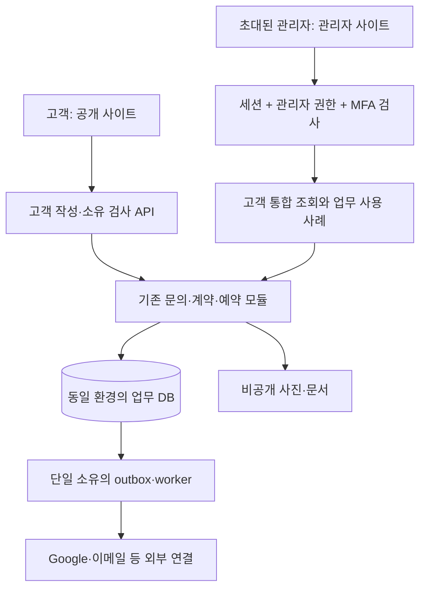

# 공개 사이트와 ESN의 분리 개발 구조

작성: 2026-10-04 · 설계 제안, 구현 미착수 · [목차](README.md)

## 분리할 대상과 선택

| 대상 | 1차 권장안 | 실제로 분리되는 것 / 남는 공유 |
| --- | --- | --- |
| 작업 이력 | `codex/esn-admin-planning`, 이후 단계별 짧은 `codex/esn-*` 브랜치 | 변경 검토 단위. 권한·데이터·배포는 분리되지 않음 |
| 계획 파일 | `docs/esn-admin/` | 상세 계획과 진행표. 기존 계획에서 링크 |
| UI·코드 | 기존 앱의 `/admin`과 업무별 모듈 | 공개 화면과 관리자 화면·규칙 분리. 단일 빌드 유지 |
| 로그인 | 직원별 관리자 인증·현재 membership·MFA 검사 | 고객 작성 쿠키·고객 인증·회사 Google API 연결과 분리 |
| 주소 | 승인 후 `admin.<회사 도메인>/admin`을 초기 진입점으로 사용 | 공개 host와 쿠키·허용 경로 구분. 같은 앱 런타임 공유 |
| 데이터 | 같은 환경에서 하나의 업무 DB·비공개 파일 저장소 | 고객·계약·예약의 일관성 유지. 공개/관리자 접근 권한 구분 |
| 환경 | 개발·시험·운영 자격 증명 및 데이터 경계 | Git 브랜치만으로 DB가 분리되지 않음. Preview에 운영 키 금지 |

`admin` 호스트의 `/`는 로그인 상태에 맞게 `/admin` 또는 로그인 화면으로 이동하도록 계획한다. 실제 경로 변경은 인증 단계에서 정하며 기존 공개 고객 URL을 일괄 이동하지 않는다.

| 대안 | 장점 | 비용·한계 | 적용 판단 |
| --- | --- | --- | --- |
| A. 단일 앱 + 관리자 모듈/host 분리 | 이미 있는 기능 재사용, 업무 트랜잭션·배포 관리가 단순 | 공개 앱과 같은 런타임·릴리스·서버 비밀 권한을 공유 | **초기 추천**, 현 단일 Next.js 지침과 일치 |
| B. 동일 저장소에 site/admin 두 앱 + 공통 패키지 | 각각 빌드·배포·환경 권한 축소, UI 출시 분리 | CI·인증 경계·공통 패키지 버전·배포 2개 관리 필요 | 독립 배포/장애 격리 요구가 확인되면 전환 |
| C. 별도 저장소·별도 DB | 독립 팀·법인 소유 경계를 크게 나눌 수 있음 | 고객 중복, 상태 동기화, 예약/결제 일관성 비용 큼 | 현재 단일 회사 고객 통합 목적에는 보류 |

주소 분리만으로 서버 침해 범위나 배포 실패가 격리된다고 설명하지 않는다. A로 시작하더라도 실제 배포 전에 B 수준의 격리가 필요한지 확인한다. 별도 Git 브랜치를 영구 운영 환경으로 사용하는 방식은 피하고 검증된 작은 변경을 통합한다.

## 1차 폴더 구조

아래 `신규` 표시는 구현 시 생성할 위치다. 이번에는 문서 폴더만 만든다.

```text
docs/esn-admin/                         계획·분석·진행 기록 (이번 생성)
src/app/admin/                         관리자 라우트와 조립 (기존 확장)
src/app/api/operations/                관리자 HTTP 진입점 (기존 확장)
src/app/api/quote/                     고객 소유 범위의 공개 작성 API (유지)
src/modules/operations/                관리자 화면 조립·기존 운영 연결
src/modules/enquiries/                 문의·초안·서명 제출·사진 (재사용)
src/modules/bookings/                  회사 기간 제안·동의·확정 (재사용)
src/modules/gmail-intake/              Gmail 수집 (재사용)
src/modules/admin-access/              직원 인증·권한·감사 포트 (신규 후보)
src/modules/customers/                 고객 마스터·연결 검토·통합 조회 (신규)
src/modules/billing/                   승인 후 인보이스·결제 (후속)
src/modules/commerce/                  상품 주문·반품 (후속)
src/shared/ui/                         사업 데이터 없는 공용 UI·토큰
supabase/migrations/                   유일한 schema 변경 이력 (유지)
scripts/integrations-worker.mjs        기존 업무 worker 조립점 (유지)
```

각 업무 모듈의 `domain`은 순수 규칙, `application`은 사용 사례·포트, `infrastructure`는 DB/Auth/Google/이메일, `presentation`은 화면을 맡는다. `src/app`은 라우트·조립만 맡는다. 다른 모듈 내부 파일 직접 참조와 거대한 ‘ESN 전체 업무 모듈’을 피하고 공개 진입점으로 조합한다. 기존 [operations 접근 진입점](../../src/modules/operations/access.ts)의 호출자를 단계적으로 새 인가 경계에 연결하며 실제 사용하는 계층만 추가한다.

계약 목록은 기존 불변 제출을 읽는 조회 모델부터 만든다. 이름이 비슷한 `contracts` 테이블을 새로 만들어 서명 원본을 복사하지 않는다. Coatly는 고객·청구 등 미구현 부분의 참고·재사용 대상으로 코드 권리·상태·수정량을 확인한다. 이미 L&K에 연결된 기능은 다시 이식하지 않는다.

## 서버와 도메인 경계



이 그림은 1차 논리 경계다. DB·서버 비밀키는 브라우저에 제공하지 않으며 `noindex`는 인증을 대신하지 않는다.

- 현재 한 개의 `APP_BASE_URL`에 묶인 **고객 origin / 관리자 origin / 회사 Google callback / 고객 문서 링크**를 목적별 설정으로 나눈다. 변수명은 구현 시 확정한다. OAuth redirect URI 변경은 회사 설정·승인에 맞춰 수행한다.
- 운영 관리자 host에서만 관리자 HTML·RSC·API·PDF·사진 경로를 허용하고, 공개 host·직접 배포 URL·미등록 host에서는 동일 경로를 차단한다. 로그인·초대·MFA·복구·정확한 callback 경로만 인증 전 예외다. 공개 API에 관리자 세션을 고객 소유 증명으로 사용하지 않는다.
- 프록시의 Host/Forwarded 값을 무조건 신뢰하지 않는다. 배포 플랫폼의 신뢰 경계를 확인하고 정규화한 allowlist와 서버 진입점 검사를 같이 적용한다. URL 호스트 제한은 보조 경계이고 모든 데이터 접근은 서버 인가가 필수다.
- 관리자 세션은 host 범위, Secure·HttpOnly·적절한 SameSite 정책으로 설계하고 상위 도메인 전체 공유 쿠키를 만들지 않는다. 실제 인증 라이브러리의 갱신·callback 흐름을 검증한다. 현재 고객 작성 쿠키 `lk_quote_draft`와 관리자 `lk_ops_session`을 혼용하지 않는다.
- 변경 요청은 메서드·Origin/CSRF·권한·revision을 검사한다. 같은 상위 도메인의 다른 서브도메인도 자동 신뢰하지 않는다. CORS의 `*` 허용으로 분리를 대신하지 않는다.
- 고객 데이터·검색·문서·사진은 `private, no-store`와 요청별 권한 검사를 적용한다. 로그인 전 SSR/RSC·프리패치·오류 메시지에 고객 정보가 포함되지 않게 한다.
- 직원 로그인과 회사 Gmail/Calendar OAuth는 별도 책임이다. 관리자가 로그인했다고 자신의 개인 Calendar에 연결하지 않는다. 일반 직원에게 회사 통합 토큰·키를 노출하지 않는다.

[Next.js 인증 안내](https://nextjs.org/docs/app/guides/authentication)는 화면/Proxy 검사에만 의존하지 않고 데이터 접근 지점과 서버 실행 경로에서도 권한을 검증하도록 안내한다. 구현 전에는 설치 버전의 로컬 가이드 `node_modules/next/dist/docs/01-app/02-guides/authentication.md`와 관련 Route Handler 문서를 다시 확인한다.

## 추후 두 앱으로 분리할 때

1. 사용 중인 도메인·사용 사례·DTO·검증 코드를 공개 진입점 기준으로 정리한다. React UI와 서버 전용 어댑터의 의존성을 분리한다.
2. `apps/site`, `apps/admin`, `packages/domain`, `packages/application`, 서버 전용 어댑터와 공용 UI 패키지를 필요한 범위로 추출한다. 루트 migration과 worker 소유권은 하나로 유지한다.
3. 동일 DB에 접근할 각 서버의 최소 권한을 정한다. 브라우저 간 직접 호출 대신 각 앱의 서버 API를 사용한다. DB가 같다고 양쪽에 무제한 비밀키를 복제하는 안으로 끝내지 않는다.
4. 쿠키·callback·메일 링크·문서 접근·host 차단과 공통 패키지 변경 시 두 앱 CI를 검증한다. 두 배포가 겹쳐 실행되는 기간에도 outbox의 중복키·lease·단일 일정 점유 규칙을 보존한다.
5. 관리자 트래픽을 전환한 뒤 기존 경로를 차단한다. 기존 앱 rollback만으로 DB가 되돌아간다고 가정하지 않는다.

## 안전한 이전 순서

소스 기준선 확보 → 합성 데이터와 로컬 권한 시험 → 관리자 인증 경계 → 고객 연결/읽기 화면 → 회사 검증 → 승인된 변경 기능 → 도메인·운영 전환 순서다. schema는 추가 후 backfill·대조 후 전환하며 기존 열·테이블 삭제는 별도 단계로 둔다. 실패하면 새 ESN 경로를 닫고 기존 로컬 흐름으로 복귀한다. 이미 저장된 서명·고객·결제 기록을 reset으로 없애지 않는다. 원격 migration 이력은 현재 수동 적용 기록과 먼저 대조한다.
