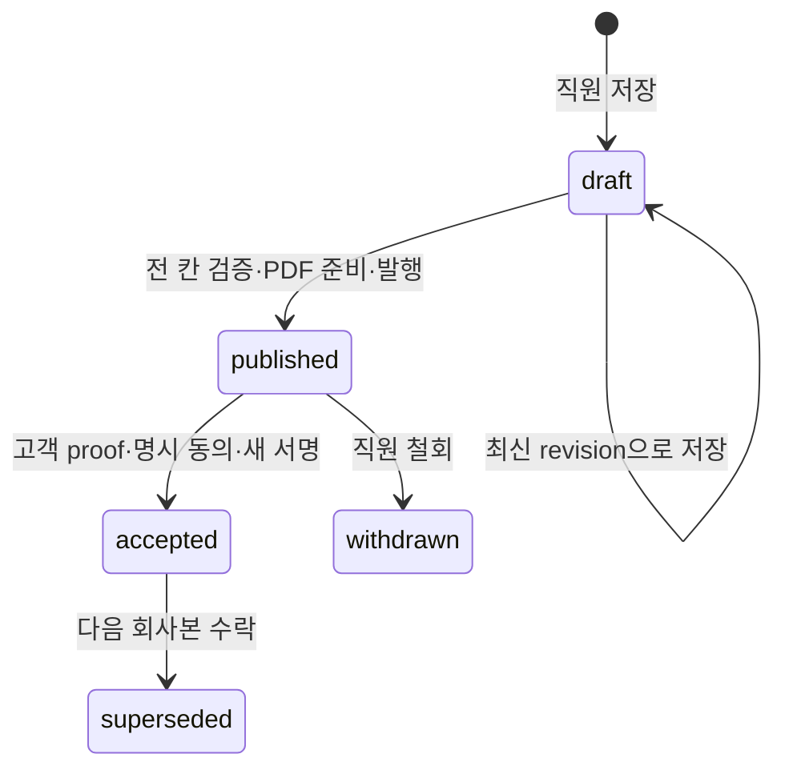

# 12 R3b 회사 수정 견적 · 고객 재확인 정책과 API 계약

작성: 2026-10-21 · Australia/Sydney · EMS R3b P1

수정: 2026-10-22 · integrator fix round 1 — 원본 GST 비교·철회 안내 발송 차단·고객 문서·확정 작업 범위·helper 최소 권한

이 문서는 백엔드·데이터 클라이언트와 후속 UI 패킷의 공유 계약이다. 회사 수정 견적은 이미 서명 제출한 예약 요청의 새 검토본이며 계약·작업 승인·청구서가 아니다. 원 고객 제출·사진·서명·snapshot/hash·PDF·발송 payload는 덮어쓰지 않는다. 회사 DB 적용·배포·실제 제공자 인수는 이번 로컬 구현 범위 밖이다.

## 1. 확정 결정과 보수적 기본값

| 결정 | 적용 |
| --- | --- |
| D1 직원 초안 첫 저장 | 정규화 후 고객 원본과 같은 칸은 기존 stored 규칙, 바꾼 칸만 엄격 검증. 원본의 엄격 검증 문제는 `sourceIssues`로 반환. 회사본 발행은 연락처 전 칸 엄격 검증 |
| D2 회사 금액 | 직원은 문짝·서랍 수량과 중간 수리 여부를 수정. 서버가 v3로 계산. 추가 항목은 직원이 설명·양수 정수 cents·사유 입력 |
| D3 고객 재확인 | 발행 안내 메일 → 기존 이메일 OTP 로그인 → 원본/회사본 비교 → 명시적 동의와 새 서명. GET·메일 링크 열람은 수락이 아님 |
| D4 변경 시점 | ack-v2 서명 제출 후부터 회사 예약 확정 시작 전까지. 확정된 예약의 variation은 후속 |

- 발행·철회는 현재 유효한 기존 admin/owner 직원만 수행한다.
- 새 acknowledgment 버전을 사용하며 “not a contract, work authorisation or payment obligation” 의미를 유지한다. 정식 계약 약관은 아직 없다.
- 새 회사본은 가격 v3·세금 0이다. legacy v1 회사 제안의 10% GST 산식을 재사용하지 않는다.
- 연락처 이메일 수정은 고객 접근권 이전이나 수신자 변경이 아니다. 안내·수락 영수증은 원 서명본의 인증 이메일로 보낸다. 다른 이메일의 접근권은 부여하지 않는다.
- 미발행 draft는 예약 확정을 막지 않는다. 발행 후 수락 대기는 `409 revision_awaiting_customer`로 확정을 막는다.
- 철회 시 고객 메일을 보내지 않는다. 고객은 철회 상태와 회사 연락 안내를 본다.
- 고객 거절/변경 요청 명령은 없다. 안내 메일에 회신해 회사와 연락한다.

새 acknowledgment ID는 `company-quote-revision-ack-v1`이며 본문은 다음과 같다.

> I accept this revised quote for my booking request and confirm the changes shown here. This is not a contract, work authorisation or payment obligation. Final contractual terms require separate acceptance.

정식 약관 ID인 `termsVersion`은 `null`이다. 기존 ack-v2 ID·문구·서명은 변경하지 않는다.

## 2. 가격·원본·서명 불변 조건

모든 금액 단위는 AUD cents이며 클라이언트 합계는 입력으로 받지 않는다.

```text
painting = doorCount × 15000 + drawerCount × 10000
minimumAdjustment = max(0, 145000 − painting)
repair = moderateRepair ? 25000 : 0
subtotal = painting + minimumAdjustment + repair + sum(extraItems.amountCents)
tax = 0
total = subtotal
pricingVersion = lk-sydney-cabinet-v3-20261014
```

최소 보정은 문짝·서랍 도장비에 먼저 적용하고 수리비·추가 항목은 그 뒤 더한다. 예를 들어 문짝 1개·서랍 0개·중간 수리 있음·추가 A$50이면 A$1,450 + A$250 + A$50 = A$1,750이다. 추가 항목 상한과 개수 제한은 입력 실수를 방지하는 기술 제한이며 사업 가격표가 아니다. 음수·0·소수 금액은 거절한다.

수량은 각각 0~500의 정수이고 합계는 1 이상이다. 추가 항목은 최대 30개이며 항목당 상한은 `MAX_EXTRA_ITEM_CENTS_TECHNICAL = 10000000`이다. 항목 ID는 고유한 UUID v4, 설명과 사유는 각각 최대 500자, `customerNote`는 최대 3000자다. 문자열은 정규화하고 HTML 입력을 거절한다.

회사본의 `comparison`은 항상 최초 서명 제출본 대비 수량·항목·합계·차액을 제공한다. 두 번째 이후 회사본의 편집 시작점은 최신 유효 수락본이며 `basedOnRevisionId`로 구별한다. 직원 초안·고객 마스터 변경으로 과거 서명 증거를 바꾸지 않는다.

원본 비교 금액은 서명 snapshot의 저장된 `subtotal`, `tax`(또는 `gst`), `total`을 보존한다. 세금 값이 없고 subtotal이 있으면 `total − subtotal`, subtotal이 없고 명시 세금이 있으면 `total − tax`로 도출한다. subtotal과 세금이 모두 없으면 추정하지 않고 거절한다. `tax`와 `gst`가 함께 있으면 같아야 하며 각 금액은 음수가 아닌 safe integer이고 `subtotalCents + taxCents === totalCents`여야 한다. 원본 `pricingVersion`이 없으면 `null`이다. 원본 항목 합으로 세금이나 subtotal을 추정하지 않는다.

따라서 GST가 포함된 원 서명본도 그대로 비교한다. 고객 PDF·메일에는 원본 subtotal·GST·total을 구분하고, 세금이 있으면 `Original GST (as signed)`로 표시한다. no-GST 안내는 회사 수정 견적에만 적용한다. 변경 내역은 문짝·서랍·전화번호 등 사람이 읽는 라벨과 값으로 표시하며 내부 필드명이나 raw JSON을 출력하지 않는다.

발행 snapshot에는 원본 submission ID·snapshot hash·signed content hash, 회사 수량·연락처·추가 항목·고객 안내·가격·비교·ack 버전을 고정한다. 수락 증거는 새 서명과 다음 hash를 별도 불변 행에 저장한다.

```text
signedContentHash = hash({ revisionSnapshot, signature, ack })
```

DB가 hash와 산술을 다시 계산한다. 서명 좌표·typed/drawn 방식은 기존 예약 요청 서명 validator와 같은 기준으로 검사한다.

## 3. 상태 머신과 동시성



발행본은 수정할 수 없다. 발행 후 미수락 상태에서는 철회한 뒤 새 draft를 만든다. 요청당 `draft | published`는 하나만 존재한다. 새 draft 또는 새 published가 있어도 이전 accepted는 다음 수락까지 유효하게 보존한다. 새 published가 있으면 이전 accepted의 존재와 관계없이 확정이 차단된다. 철회 후에는 이전 유효 accepted가 있으면 그 금액을 사용한다.

요청 단위 `revision`은 저장·발행·철회·수락마다 증가하는 낙관적 잠금 값이다. `versionNo`는 새 회사본을 만들 때 증가한다. 모든 변경은 현재 인증·회사/고객 접근권 → 요청 잠금 → receipt replay → revision·상태 재검사 → 업무·outbox·receipt·감사 기록의 단일 트랜잭션 순서다. 같은 키·같은 입력은 같은 receipt, 같은 키·다른 입력은 충돌이다. 새 수락에는 proof 만료를 검사하며 이미 성공한 명령의 응답 유실 재시도는 원 receipt로 복구한다.

회사 예약이 생겼거나 취소가 진행 중이면 새 회사본 변경은 거절한다. 확정 당시 남아 있던 미발행 draft는 보존하지만 이후 저장·발행·철회·수락은 허용하지 않는다. legacy demo·ack-v1에는 이 흐름을 적용하지 않는다.

## 4. D1 직원 초안 계약

기존 `/api/admin/quote-requests/[id]/staff-draft`의 GET·PUT 및 `/commands/[key]` GET 경로를 유지한다. PUT body는 기존 `{expectedRevision,idempotencyKey,reason,payload}` 그대로다. 클라이언트가 비교용 원본 payload를 서버에 보내지 않는다. API는 현재 DB source를 조회하고 DB도 직접 원본을 읽어 최종 검사한다.

GET 응답은 기존 `requestId, source, draft, audit, canWrite`에 다음 필드를 추가한다.

```ts
sourceIssues: Array<{ field: string; code: string; message: string }>
// field 예: payload.contact.phone, payload.contact.name
```

이는 고객 원본이 현재 엄격 검증에서 실패하는 칸의 전체 목록이다. stored 규칙을 통과하지 못하는 구조·타입·길이·제어문자까지 허용한다는 뜻은 아니다. 직원 변경 여부는 trim·이메일 소문자 등 기존 파서와 동일한 정규화 후 칸별로 비교한다. 내부 메모는 항상 검증하며 고객에게 노출하거나 메일을 보내지 않는다.

API가 입력 칸을 식별할 수 있는 current-work `422`는 `{error,code,outcome:'not_applied',fields:{[field]:message}}`를 반환한다. DB의 매핑되지 않은 LK422 오류는 안전한 일반 메시지를 유지한다. UI는 `sourceIssues`와 저장 시 `fields`를 구분한다.

## 5. API 계약

아래 계약은 구현 DTO와 최종 대조하여 같은 파일에서 유지한다. 모든 JSON 응답은 비공개 `no-store`이며 Cookie에 따라 달라진다. 직원 API는 최신 직원 세션과 업무 권한을, 고객 API는 기존 OTP 세션과 선택 요청의 `lk_quote_request_access`를 검사한다. 쓰기는 same-origin JSON 요청이다. 고객 요청 선택은 기존 `x-lk-quote-request-id` 계약을 따른다.

### 관리자 경로

기준 경로: `/api/admin/quote-requests/[id]/company-revisions`

| 메서드·상대 경로 | 동작 |
| --- | --- |
| GET 기준 경로 | 자격·현재본·초기 입력·비교·이력 조회 |
| PUT 기준 경로 | draft 생성/수정 |
| POST `/publish` | 검증·고정 PDF·메일 payload 준비 후 원자 발행 |
| POST `/withdraw` | 발행·미수락본 철회, 고객 메일 없음 |
| GET `/history` | 회사본·감사 이력 |
| GET `/commands/[key]` | 해당 요청·직원 명령 receipt 조회 |

요청별 회사본 목록은 GET 기준 경로의 `revisions` 배열이다. 별도 전사 목록이나 별도 list URL은 추가하지 않는다. `/history`는 같은 요청의 회사본 목록과 감사 이력을 포함한 상세 상태를 반환한다.

```ts
type RevisionPayload = {
  contact: {
    name: string; email: string; phone: string; siteAddress: string
    suburb: string; postcode: string; details: string
  }
  quantities: { doorCount: number; drawerCount: number; moderateRepair: boolean }
  extraItems: Array<{ id: string; description: string; amountCents: number; reason: string }>
  customerNote: string
}
type SaveBody = {
  expectedRevision: number; idempotencyKey: string; reason: string
  payload: RevisionPayload
}
type PublishOrWithdrawBody = {
  revisionId: string; expectedRevision: number; idempotencyKey: string; reason: string
}
```

공개 입력에는 가격·합계·hash·PDF·수신자·발송 payload를 포함하지 않는다.

### 고객 경로

기준 경로: `/api/quote/requests/company-revision`

| 메서드·상대 경로 | 동작 |
| --- | --- |
| GET 기준 경로 | 발행된 현재 상태와 원본 비교. 수락하지 않음 |
| POST `/review` | 지정 발행본을 재검사하고 짧은 수명 review proof 발급 |
| POST `/accept` | 명시적 동의·새 서명을 검증해 불변 수락본과 outbox 저장 |
| GET `/commands/[key]` | 해당 고객의 수락 receipt 조회 |

```ts
type ReviewBody = { revisionId: string; snapshotHash: string }
type AcceptBody = {
  revisionId: string; expectedRevision: number; reviewProof: string
  acknowledgmentVersion: string; acknowledged: true
  signature: {
    name: string; method?: 'typed' | 'drawn'
    strokes: Array<Array<{ x: number; y: number }>>; acknowledged: true
  }
  idempotencyKey: string
}
```

proof는 고객 principal·owner hash·선택 request·회사본 ID/hash·ack에 결합한 AES-GCM 문자열이며 메일 URL에 포함하지 않는다. 다른 고객·다른 요청·만료·변조·철회·대체·이미 수락된 회사본에 대한 새 수락은 거절한다.

### 응답 DTO

직원 GET detail/history와 고객 GET state는 각각 상태 객체를 직접 반환한다. 직원 변경·receipt 조회는 `{detail, receipt}`, 고객 수락·receipt 조회는 `{state, receipt}`를 반환한다.

```ts
type RevisionReceipt = {
  idempotencyKey: string; entityType: 'company_revision'
  entityId: string // requestId
  childId: string // 회사본 ID
  action: 'revision_save' | 'revision_publish' | 'revision_withdraw' | 'customer_accept'
  revision: number; committedAt: string
}
type Pricing = {
  pricingVersion: 'lk-sydney-cabinet-v3-20261014'
  currency: 'AUD'; amountUnit: 'cents'; minimumSubtotal: 145000; gstRateBps: 0
  lineItems: Array<{code:string;label:string;quantity:number;unitAmount:number;amount:number}>
  subtotal: number; tax: 0; total: number
}
type Comparison = {
  original: {
    quantities: RevisionPayload['quantities']; lineItems: Pricing['lineItems']
    subtotalCents:number; taxCents:number; totalCents:number; pricingVersion:string|null
  }
  company: { quantities: RevisionPayload['quantities']; lineItems: Pricing['lineItems']; totalCents:number }
  deltaCents: number
  changes: Array<{field:string;before:unknown;after:unknown}>
}
type RevisionSnapshot = {
  schemaVersion: 'company-quote-revision-v1'; companyId: 'lk-group'
  requestId:string;revisionId:string;versionNo:number
  baseSubmissionId:string;baseSnapshotHash:string;baseSignedContentHash:string
  basedOnRevisionId:string|null
  contact:RevisionPayload['contact'];quantities:RevisionPayload['quantities']
  extraItems:RevisionPayload['extraItems'];customerNote:string
  pricing:Pricing;comparison:Comparison
  acknowledgment:{version:'company-quote-revision-ack-v1';text:string};termsVersion:null
}
type Acceptance = {
  id:string;revisionId:string;snapshotHash:string
  signature:AcceptBody['signature'];acknowledgment:RevisionSnapshot['acknowledgment']
  signedContentHash:string;acceptedAt:string
}
type Revision = {
  id:string;requestId:string;versionNo:number;revision:number
  status:'draft'|'published'|'accepted'|'superseded'|'withdrawn'
  baseSubmissionId:string;baseSnapshotHash:string;baseSignedContentHash:string
  basedOnRevisionId:string|null
  payload:RevisionPayload;pricing:Pricing;totalCents:number;comparison:Comparison
  snapshot:RevisionSnapshot|null;snapshotHash:string|null
  publishedAt:string|null;acceptedAt:string|null;withdrawnAt:string|null
  acceptance:Acceptance|null;emailStatus:string|null;receiptReady:boolean
}
type CustomerState = {
  requestId:string;revision:number;current:Revision|null;effectiveAccepted:Revision|null
  acknowledgment:RevisionSnapshot['acknowledgment']
}
type StaffDetail = CustomerState & {
  eligible:boolean;eligibilityCode:string|null;canWrite:boolean
  sourceIssues:Array<{field:string;code:string;message:string}>
  initialPayload:RevisionPayload;revisions:Revision[]
  audit:Array<{
    id:string;action:string;actorUserId:string;actorSessionId:string;reason:string
    priorRevision:number;newRevision:number;details:Record<string,unknown>;createdAt:string
  }>
}
```

`emailStatus`는 `pending | sending | provider_accepted | retrying | failed | manual_review | cancelled` 또는 outbox가 없을 때 `null`이다. `cancelled`는 철회 전에 시도되지 않은 안내 메일의 종결 상태다. 전송 결과 불명은 같은 키로 재시도하는 `retrying`과 내부 오류 코드로 기록하며, 재시도 창이 지나면 `manual_review`가 된다. `receiptReady`는 고정 PDF가 존재함을 뜻하며 제공자 배달을 뜻하지 않는다. `current`는 직원에게 최신 version을, 고객에게 draft를 제외한 최신 발행 이력을 가리킨다. `effectiveAccepted`는 현재 유효 수락본이다. 고객 응답에는 직원 draft·초기 입력·직원 변경 사유·감사 목록이 포함되지 않는다.

`review` 응답은 `{review:{state,revision,snapshot,snapshotHash,expiresAt,reviewProof}}`이다. `expiresAt`은 서버 시각 기준 15분 뒤의 ISO 순간값이다. 새 수락에는 현재 회사본의 `revision`을 `expectedRevision`으로 보낸다. 모든 시간은 UTC ISO 순간값으로 저장하고 Sydney로 표시한다.

감사 `details`는 `{prior, new}`이며 생성 전 `prior`는 `null`이다. 각 요약에는 `revisionId, versionNo, revision, status, quantities, totalCents, pricingVersion, baseSubmissionId, baseSnapshotHash, baseSignedContentHash, basedOnRevisionId, snapshotHash, payloadHash, acceptanceId, signedContentHash`를 담는다. 값이 아직 없으면 `null`이다. 연락처·안내문·추가 항목 자유문구·raw snapshot·서명 좌표·PDF를 감사 로그에 중복 저장하지 않고 원본 행 ID와 hash로 연결한다.

### 오류 계약

```ts
type RevisionError = {
  error:string;code:string;outcome:'not_applied'|'unknown'
  currentRevision?:number;fields?:Record<string,string>
}
```

| 상태 | code | UI 처리 |
| --- | --- | --- |
| 400 | `validation` / `malformed_request` | 잘못된 서명·JSON·입력 형식 수정 |
| 401 / 403 | `unauthorized` / `forbidden` | 비공개 데이터·보류 입력을 지우고 다시 로그인 |
| 403 | `review_owner_mismatch` | 다른 요청의 proof를 사용하지 않음 |
| 404 | `not_found` | 요청·명령 조회 대상 없음 |
| 409 | `revision_conflict` / `idempotency_conflict` | 입력 유지, 최신본·명령 결과 조회 후 재확인 |
| 409 | `revision_not_eligible` / `booking_confirmed` / `cancellation_started` | 회사본 변경 자격 없음 |
| 409 | `revision_published` / `revision_not_published` | 현재 상태와 맞지 않는 명령 |
| 409 | `revision_snapshot_changed` | 최신 발행본으로 다시 비교·review |
| 409 | `revision_acceptance_invalid` | 수락 증거가 일치하지 않음. 새 확정을 진행하지 않고 회사 확인 |
| 409 | `review_proof_invalid` / `review_proof_expired` | 현재본을 다시 review하고 새 서명 |
| 409 | `revision_awaiting_customer` | 고객 수락 전 예약 확정 차단 |
| 422 | `validation` / `acknowledgment_required` / `review_required` | `fields`가 있으면 해당 칸 표시, 입력 유지 |
| 413 / 415 | `request_too_large` / `unsupported_media_type` | JSON·용량 제한에 맞춰 입력 수정 |
| 503 | `unavailable` | 명시된 `not_applied`이면 입력 보존 후 재시도 |
| 503 | `outcome_unknown` | 키·payload를 바꾸지 않고 receipt 조회/같은 요청 재시도 |

신규 키로 이미 accepted인 회사본을 수락하려 하면 상태 오류다. 성공한 키의 동일 내용 replay만 예외다. `fields`는 신뢰할 수 있는 필드명·제한된 문자열만 클라이언트가 사용한다.

## 6. outbox와 예약 확정

새 outbox 종류는 `revision_notice`와 `revision_acceptance_receipt`다. 발행·수락 RPC와 같은 트랜잭션에서 각각 한 건만 만든다. 서버가 미리 pdf-lib로 만든 PDF·SHA-256·메일 payload를 고정하고 worker는 같은 바이트와 provider Idempotency-Key를 사용한다. prepare와 commit 사이 revision/hash가 달라지면 저장을 거절한다.

링크는 비밀 토큰이 없는 기존 저장 견적 복귀 경로를 가리키고 고객은 OTP로 로그인한다. 회신 주소는 기존 회사 sender 검증을 사용한다. 제공자 수락은 배달 완료와 구별한다.

worker는 lease fencing·전송 결과 저장·기존 23시간 재시도 창을 적용하고, 결과 불명 상태가 제공자의 중복 방지 창을 넘으면 수동 검토로 전환한다. 기존 `/api/internal/live-bookings/process`와 즉시 `after()`에서 처리한다. cron 시각은 유지한다. 철회 메일과 새 Calendar 이벤트는 만들지 않는다.

철회할 때 해당 회사본의 `revision_notice` 중 `email_first_attempt_at IS NULL`인 메일은 `cancelled`, 사유 `revision_withdrawn`으로 종료하고 lease를 해제한다. 이미 시도한 행의 상태·시도·제공자 증거는 보존한다. worker는 `published` 회사본의 안내 메일만 claim하며 발송 시도 등록 직전에도 요청 잠금 아래 상태를 다시 검사한다. 따라서 철회되거나 이미 수락된 회사본의 안내 메일은 새로 발송·재시도하지 않는다. 수락 영수증은 이 안내 메일 제한과 별개로 처리한다. 최초 시도 등록을 마쳐 이미 제공자에게 전송 중이거나 전송된 메일은 회수할 수 없다. 실패 후 `retrying`인 안내 메일도 철회 후에는 다시 claim하지 않는다.

예약 확정은 발행 후 고객 수락 대기본이 있으면 `409 revision_awaiting_customer`로 차단한다. 유효 수락본이 있으면 확정 snapshot·예약 행·확정 PDF/메일에 회사본 금액과 `accepted_revision`, 회사본 ID·새 signed hash를 고정한다. 원 서명의 hash는 원 서명 증거로 별도 보존한다. 미발행 회사본만 있으면 기존대로 확정할 수 있다. 전체 기간 충돌 검사·원자적 점유·Calendar 재조회 후 확정 통지하는 기존 보장을 유지한다.

수락 회사본으로 확정하는 작업 범위는 수락한 수량의 `N cabinet doors, M drawer fronts` 요약으로 항상 채운다. `customerNote`는 공백을 제거한 뒤 비어 있지 않을 때만 줄을 바꿔 덧붙인다. 수량 외의 작업 조건을 새로 만들지 않는다.

예약 응답의 증거 필드는 `companyRevisionId`, `companyRevisionSnapshotHash`, `companyRevisionAcceptanceId`, `companyRevisionSignedContentHash`다. `accepted_revision`에서는 네 값이 필수이며 기존 `signedSubmissionId`도 원 제출을 가리킨다. 기존 R3a 취소는 이 새 basis에서도 같은 일정 소유 검증·삭제 확인·점유 해제 절차를 따르며, 새 variation이나 고객 취소·환불 정책은 추가하지 않는다.

## 7. 미결정 사항

할인·음수 항목, 고객 거절/변경 요청 조작, 철회 통지 방침, 확정 예약의 variation, 정식 계약 약관·서명 보존 정책은 미결정이다. 이번 보수적 기본값을 이들에 대한 승인으로 해석하지 않는다.

## 8. migration과 검증·적용 순서

기존 적용 migration과 R3a migration은 수정하지 않는다. 이번 integrator 수정은 신규·미적용인 아래 R3b 두 파일에만 반영했다. 회사 적용 시 기존 미적용 R3a 두 개를 먼저 적용하고 R3b migration을 파일명 순서대로 적용한 뒤 이 API를 사용하는 코드를 공개한다. 이번 작업에서는 회사 DB에 적용하지 않는다.

1. `20261020094056_ems_r3a_current_work_management.sql`
2. `20261020101429_ems_customer_resolve_revision_guard.sql`
3. `20261021090000_ems_r3b_staff_draft_validation.sql`
4. `20261021091000_ems_r3b_company_revisions.sql`

새 테이블은 `lk_quote_company_revisions`, `lk_quote_company_revision_acceptances`, `lk_quote_company_revision_outbox`, `lk_quote_company_revision_receipts`, `lk_quote_company_revision_audit`다. 기존 `lk_quote_versions`·약관·수락 골격과 v1 재확인 테이블을 새 회사본으로 전용하지 않는다. 신규 표는 RLS를 활성화하고 public/anon/authenticated 권한을 주지 않는다. 서비스 역할 전용 형제 RPC `lk_quote_company_revision_command`와 기존 회사 확정 RPC의 검증된 경계를 사용한다. 보안 정의자 함수는 빈 `search_path`와 명시적 스키마명을 사용한다.

`lk_private.staff_quote_*` helper는 서비스 역할에도 직접 EXECUTE를 부여하지 않는다. 직원 초안·회사본 RPC와 trigger의 SECURITY DEFINER 호출 체인 안에서만 사용한다.

검증은 합성 domain/API·PGlite의 전체 migration 재생·제공자 주입 worker·클라이언트 요청 수명을 구별한다. 최종 실행 명령과 건수는 작업 결과에 기록한다. 실제 브라우저 UI·실제 메일/Google/AI·운영 DB·빌드는 이번 검증에 포함하지 않는다.
