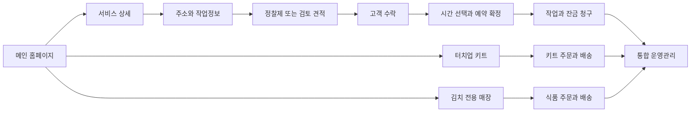

# 화면과 고객 여정

**2026-10-04 ESN 개정:** 공개 고객 화면과 관리자 ESN의 메뉴·화면·권한을 분리한다. 이번에는 [ESN 분리 계획](../esn-admin/02-separation-architecture.md)을 작성하며 라우트나 화면을 구현하지 않는다. 초기 ESN은 초대된 관리자 전용이고 고객 계정·현장 직원 포털은 후속 범위다. 고객별 문의·계약/서명·예약·사진부터 통합하고 주문/청구는 해당 업무 구현 후 연결한다. 전체 진행 상태는 [ESN 진행표](../esn-admin/05-progress.md)를 따른다.

## 사이트 구조

초기 권장안은 하나의 Next.js 프로젝트와 업무 DB를 유지하며 공개·고객·관리자 경로와 권한을 구분하는 것이다. 고객 작성 쿠키나 향후 고객 로그인은 관리자 권한을 부여하지 않는다. 회사 도메인이 확인되면 `admin.<회사 도메인>`과 승인된 host 목록을 검토하되 같은 런타임의 화면 분리이며 독립 배포는 아니다. 다음 URL은 전체 목표의 제안 경로이며 도메인 소유권이나 구현 완료를 가정하지 않는다.

```text
/
├── /about
├── /services
│   ├── /handyman
│   │   ├── /silicone-resealing
│   │   ├── /door-repairs
│   │   ├── /flyscreen-replacement
│   │   ├── /wall-mounting
│   │   └── /tile-replacement
│   ├── /painting/interior
│   ├── /painting/exterior
│   └── /cabinet-painting
├── /service-areas
├── /quote/start
├── /booking
├── /products
│   ├── /touch-up-kits
│   └── /touch-up-kits/[slug]
├── /kimchi
│   └── /[slug]
├── /cart/kits  /cart/kimchi
├── /checkout  /order/confirmation
├── /projects/[slug]  /guides/[slug]
├── /contact  /faq
├── /account/quotes  /account/bookings  /account/orders
├── /policies/privacy  /policies/terms
├── /policies/shipping  /policies/returns
└── /admin
```

관리자와 고객 페이지는 검색 제외하고 서버에서도 권한을 검사한다. noindex나 숨겨진 URL은 보안 수단이 아니다. 기존 공개 URL이 있다면 실제 목록을 확보한 뒤 301 매핑한다. 확인되지 않은 URL에 임의 리다이렉트를 만들지 않는다.

ESN의 제안 메뉴는 대시보드 → 고객 목록/고객 상세 → 문의 → 계약·서명 문서 → 예약·작업 → 주문·구매 → 인보이스·입금 → 연동/실패 기록 → 관리자 설정이다. 현재 `/admin` 문의·예약 검토 기반에서 필요한 화면만 순서대로 확장한다. 아직 구현하지 않은 주문·매출은 0이나 완료로 꾸미지 않으며, [단계별 범위](../esn-admin/04-roadmap-and-acceptance.md)에 따라 메뉴를 연결한다.



## KCP 견적 화면 개정 — 2026-10-02

KCP는 [32번 고객 제출 계약](32-client-quote-signature-submission.md), [18번](18-kcp-page-prototype.md), [25번 실행 순서](25-kcp-quote-to-booking-implementation.md)를 우선한다. 전용 `/quote/start?service=cabinet-painting`에서 **고객 정보·디테일 저장 → 서비스·사진 → AI/가격 → 고객 approve → 앱 달력 시작일 → 최종 확인·서명·제출 → 최종 견적/서명 계약 이메일 → 회사 Calendar**로 진행한다. 회사 기간·충돌 확인 전에는 `Pending confirmation` 요청이며, 이미 예약된 날짜는 선택을 막고 제출 시 서버에서 재검사한다. 위 일반 흐름도와 아래 페이지 표의 단순 ‘수락→예약’은 이 단계들을 생략하지 않는다.

위 2026-10-02 최초 범위는 고객 초안 선저장·서비스 정보 입력과 연동 복구였다. 이후 회사 전용 데모의 날짜·서명·PDF/메일·예약 검토와 비공개 사진을 구현했으며 실제 범위는 [33번](33-admin-booking-confirmation-day-plan.md)·[35번](35-mobile-booking-private-photo-plan.md)과 검증 기록을 따른다. AI·운영 가격/약관·고객 인증·청구/결제까지 완료한 것은 아니다.

## 페이지별 구성

| 화면 | 첫 화면에서 답할 질문 | 주요 구성과 행동 |
| --- | --- | --- |
| 메인 | 어떤 도움을 받을 수 있는가 | 집수리·페인팅·키트·김치 분기, 실제 작업 사례, 지역 확인 |
| 서비스 카테고리 | 내 작업이 포함되는가 | 제공 범위, 작업 카드, 제외 작업, 상담 버튼 |
| 서비스 상세 | 얼마이며 무엇이 포함되는가 | 가격 조건, 전후 사진, 포함·제외, 예상 시간, 보증·FAQ, Get a Quote |
| 견적 | 무엇을 제출해야 하는가 | KCP는 고객 정보 선저장 → 서비스/사진 → AI/가격, 서버 저장 상태와 단계 보존 |
| 수락·서명 | 무엇에 동의하는가 | 고객 approve와 최종 확인·서명 분리, 고정 버전·금액·약관·요청 날짜 확인, 변경 시 재서명 |
| 예약 | 언제 작업 가능한가 | 예약 날짜 선택 불가·서버 재검사, 회사 기간·충돌 확인 전 요청 표시, 승인된 예약금/변경 정책 |
| 키트 상세 | 내가 쓸 색과 구성이 맞는가 | 구성품·용량·옵션·색상 정보·납기·배송·사용법 |
| 김치 상세 | 먹을 수 있고 배송받을 수 있는가 | 성분·알레르겐·중량·보관·배송지역·날짜·유통기한 기준 |
| 관리자 첫 화면 | 오늘 무엇을 처리해야 하는가 | 검토 대기, 오늘 작업, 미출고, 재고 경고, 미수금, 자동화 실패 |

김치는 페인트 이미지·공구 아이콘과 분리된 전용 화면을 갖는다. 그룹 관계는 푸터의 사업자 안내로 명확히 하고, 식품 페이지의 주요 메뉴와 추천상품은 식품 중심으로 유지한다. 시공 고객에게 김치 마케팅을 보내려면 별도 관심·동의가 필요하다.

## 모바일 사용 조건

375px 화면에서 주소·가격·다음 버튼이 잘리면 안 된다. 단계마다 제목, 진행 상태, 이전 버튼을 제공한다. 사진은 모바일 카메라·갤러리 모두 지원하고 HEIC는 서버에서 안전하게 변환하는 방안을 검증한다. 업로드 실패 시 기존 입력을 보존한다.

고정 하단 버튼은 쿠키 안내, 키보드, 오류 메시지와 겹치지 않게 한다. 색상만으로 오류를 표현하지 않고 필드별 설명과 요약을 표시한다. 예약 시간은 Sydney 현지 시간과 날짜를 보여주며, 직원 화면은 야외에서도 읽히는 대비와 큰 터치 영역을 제공한다. WCAG 2.2 AA를 제품 목표로 두고 키보드·스크린리더의 핵심 흐름을 검증한다.

## 주요 예외 화면

- 주소 밖: 자동예약 불가를 알려주고 문의 전환. 예외 승인은 담당자와 사유를 기록한다.
- 주소 불명확: 아파트·유닛 번호 보완 또는 수동 검토. 비용 청구 전 해결한다.
- 사진 부족: 필요한 추가 사진의 구도를 예시로 안내하고 상담 방식 제공.
- AI 대기: 저장된 입력과 처리 상태를 앱에 표시하며 실패해도 문의는 사라지지 않는다. AI 완료만으로 최종 계약 이메일이나 Calendar를 실행하지 않는다. 별도 알림은 승인 채널이 연결된 경우만 제공한다.
- 최종 서명 후 조건 변경: 바뀐 견적·약관·날짜를 표시하고 재확인·재서명을 요구한다.
- 문서·메일·Calendar 실패: 제출 원본은 유지하고 각 작업의 상태·재시도를 구분한다. 이메일 제공자 수락을 실제 배달 완료로 표시하지 않는다.
- 품절: 결제 진입 차단, 대체 상품 또는 동의 기반 입고 알림.
- 김치 배송 불가: 결제 전 차단, 가능한 픽업이 실제 있을 때만 제시.
- 결제 후 확인 지연: 중복 결제를 유도하지 않고 주문번호와 확인 중 상태를 제공.

## 콘텐츠 관리 기준

관리자는 페이지 제목, 요약, 본문, 사진 대체텍스트, FAQ, SEO 제목·설명, 공개 여부를 수정한다. HTML 임의 입력은 제한된 편집기로 정화한다. 가격과 예약 규칙은 일반 본문이 아닌 승인된 카탈로그에서 불러와 불일치를 줄인다.

영어를 초기 언어로 하고 한국어는 번역 승인 후 명시적 locale 경로로 도입한다. 이때 영문 기존 URL 정책, canonical, hreflang, sitemap을 함께 정한다. 자동번역만으로 계약·알레르겐·반품 정책을 게시하지 않는다.
