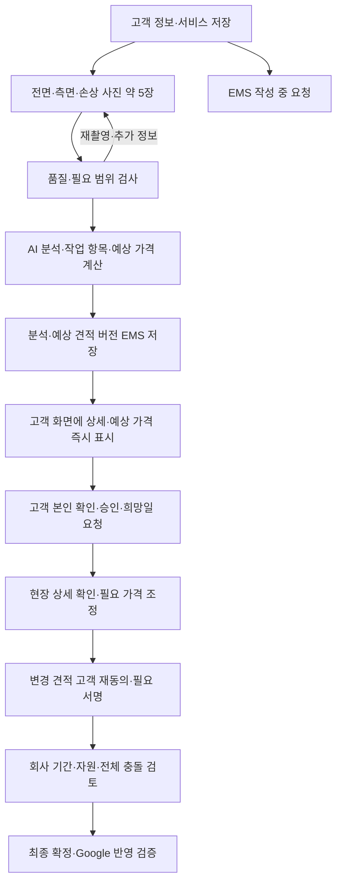

# 실제 고객 Quote → EMS → 예약 운영 전환 계획

**2026-10-12 최신 구현 — 41번 1~2단계 인수 완료:** `codex/domain-customer-quote-auth-20261012`에서 www origin·회사 발신/SMTP·고객 OTP/요청별 복구·이전 주소 일회용 이전을 구현/설정했다. 자동 검사 **558/558개**·lint·타입·빌드, 회사 SQL 적용·기존 요청 12건/사진 29건/분석 15건 hash 보존·신규 세 테이블 익명 차단과 Vercel READY를 확인했다. 회사 Chrome에서 OTP 배달/인증·직원 로그인·기존 요청 동일 ID 이전·www 저장/5장 업로드 → AI **15문/6서랍 A$3,135 GST 포함** → 고객/EMS/DB 대조 → 고객 로그아웃/직원 로그인 유지 → 새 고객 세션 재인증/동일 사진·분석/금액 복구·새로고침 보존까지 확인했다. **실제 다른 물리 기기·미가입 신규 이메일/signup은 미검증**이며 별도 고객 세션 복구와 구분한다. 해당 Vercel 배포는 작업 브랜치 검증 당시 CLI로 수행했으며 Git 통합과 별도로 기록한다. 이후 예상본 승인 → 날짜·약관·서명 → live PDF/고객 메일 → 회사 Google 확정은 미구현이다. [41번 계획](41-domain-live-quote-booking-plan.md)·[인수 기록](../verification/2026-10-12-domain-customer-quote-auth.md)을 따른다.

**2026-10-11 최신 RQ-04b:** [40번 AI 수량 추정 가견적](40-ai-quantity-provisional-estimates.md)을 회사 Vercel/Supabase에 적용했다. 고객 입력 수량이 없어도 추정 문·서랍으로 예상 도장비를 표시하고 정확한 수량·최종 가격은 현장 확인 후 조정한다. 사진 5장씩 3세트의 숫자 결과와 고객/EMS/DB 일치, 전체 524개 검사 및 lint·타입·빌드를 확인했다. 서로 다른 사진을 합산하지 않은 `primary_view` 도장비이며 실제 동일 현장의 실측 정확도·RQ-04c 최종 견적 수정/발행은 후속이다. [검증 기록](../verification/2026-10-11-ai-quantity-provisional-estimates.md). 아래 v1 완료 상태는 당시 기록이다.

**후속 인수 완료(2026-10-11):** 회사 Chrome에서 실제 두 사진 업로드 → AI 분석 → 새로고침 복원 → EMS 동일 결과를 확인했다. 새 가격 SQL 적용과 익명 차단도 확인했다. 실제 사례는 사진 부족으로 `review_required`/총액 null이며, 전체 사진의 정상 숫자 총액 인수는 남는다. [검증 기록](../verification/2026-10-11-pricing-browser-qa.md).
2026-10-12 개정 · Australia/Sydney · 상태: **RQ-04a 및 RQ-04b v2 생성 예시 숫자 결과 인수 완료 / 실제 현장 실측 정확도·RQ-04c 후속 / 운영 origin·회사 발신 및 고객 OTP/별도 세션 복구 실제 인수 완료 / 물리 다른 기기·신규 가입 미검증 / 예상본 승인·예약 연결 후속**. 위 두 사진과 아래 v1 설명은 당시 기록이다.

최초 계획 기준은 로컬 `main@3f7e8c9`와 기존 데모 브랜치의 미커밋 변경이다. 후속 사용자 승인으로 기존 변경을 보존한 `codex/live-quote-ems-foundation-20261008`에서 RQ-00~02를 구현하고 회사 Supabase에 추가 migration을 적용했다. 로컬 앱과 회사 Chrome의 저장·복원·EMS 조회를 확인했다. [실행 증거](../verification/2026-10-08-live-quote-foundation.md). **10월 8일 당시에는** 이 코드의 Vercel 배포·고객 발송·계약/예약 확정을 수행하지 않았다. 최신 배포·설정 상태는 위 10월 12일 기록을 따른다.

**2026-10-11 사용자 흐름 및 후속 검증:** 고객이 사진 약 5장 업로드 → AI 분석 → 분석 결과·가격 상태 표시 → 동일 결과 EMS 자동 저장 → 현장 확인 후 필요 가격 조정으로 진행한다. 초기 가격 v1은 GST 별도 시작가 A$1,500·문 A$150·서랍 앞판 A$100·중간 도막 보수 A$250(프로젝트당 한 번)·GST 10%로 구현했다. 충분한 사진·확인 수량·허용 범위이면 단일 예상 총액을 표시하고, 정보/범위/손상 검토가 필요하면 `review_required`/null로 두며 시작가만 표시한다. 이전 `awaiting_company_rates`/null 결과는 보존한다. 실제 AI API 호출, 저장 결과 일치, 명시적 동일 작업 재호출의 중복 방지를 확인해 RQ-04a API·저장 검증을 완료했다. 가격 v1 전체 자동 테스트 **488/488**과 마지막 입력 name 보완 후 `npm run check`는 통과했으며 회사 Chrome에서 실제 두 손상 사진의 `review_required`/총액 null·새로고침 복원·EMS 동일 결과와 키보드 분석 시작·320px 메뉴/가격 가독성을 확인했다. 정상 총액을 계산할 충분한 실제 사진 세트 인수는 남는다. 가격 규칙은 [39번 초기 가격 문서](39-sydney-cabinet-pricing-v1.md), 세부 인수 기준은 [38번 AI 사진 견적 계획](38-ai-photo-estimate-and-ems-plan.md)을 따르며 아래 RQ-00~02의 날짜별 기록은 보존한다. [검증 기록](../verification/2026-10-11-ai-photo-analysis.md).

[전체 TODO](15-home-cabinet-admin-todo.md) · [기존 고객 흐름](32-client-quote-signature-submission.md) · [데모 인수 기록](../verification/2026-10-08-quote-damage-demo.md) · [EMS 진행표](../esn-admin/05-progress.md)

## 1. 이번 결정과 완료 목표

사용자는 데모 금액·회사 시험 이메일 제한을 넘어서 실제 고객 정보와 사진을 저장하고, 실제 견적을 확인·승인한 뒤 날짜를 선택해 예약하는 흐름을 요청했다. 계획 작성 후 RQ-00~02 구현 승인을 받아 첫 저장·EMS 연결을 완료했다.

| 구분 | 결정·현재 상태 |
| --- | --- |
| 실제 가격 | **고객 사진 AI 분석 후 상세·예상 가격 즉시 표시, EMS 자동 저장, 현장 확인 후 필요 조정**. [가격 v2](40-ai-quantity-provisional-estimates.md): 최소 도장비 A$1,500·문 A$150·서랍 앞판 A$100·선택한 동일 범위 중간 도막 보수 A$250 1회(GST 별도), GST 10%. AI 추정 수량을 사용하며 미산정 범위는 별도 표시 |
| 자동 가격·AI | OpenAI gpt-6.1-sol / medium·가격 v2 구현 및 생성 예시 5장씩 3세트 숫자 결과 고객/EMS/DB 인수 완료. 실제 동일 현장 실측 정확도·호출 예산·품질 평가는 후속 |
| 웹 주소 | 회사 Vercel `lnkgroup`의 **https://www.lnkgroupsydney.com.au**. API 200·저장/5장 업로드/AI·직원 로그인·이전 요청 이전·고객 별도 세션 복구/새로고침·EMS/DB 대조 확인. 실제 다른 물리 기기는 미검증 |
| 메일 도메인 | `lnkgroupsydney.com.au` Resend verified/sending enabled. 회사 발신 `quotes@lnkgroupsydney.com.au`·Reply-To 회사 Gmail·Auth custom SMTP 반영. 실제 고객 OTP delivered/사용자 인증·직원 코드 수신 확인; live PDF/배달 추적은 후속 |
| 입력 주체 | 고객이 일반 Cabinet 페이지에서 직접 입력·사진 업로드·자동 예상 견적 확인. 직원 대리 작성은 별도 후속 |
| 회사 계정 | `lnkgroupsydney@gmail.com`, 지정 회사 Supabase 프로젝트 유지 |
| 예약 확정 | 기존 확정 유지: 고객 날짜 선택·서명 제출은 요청. **회사가 기간·자원·전체 충돌을 확인한 뒤 확정** |
| 날짜 차단 | 이미 예약된 날짜는 고객 달력과 서버에서 차단. 정확한 작업 기간은 회사 검토로 결정 |
| 정식 약관 | 제공·승인 여부 미확인. 데모 약관을 정식 계약에 사용하지 않음 |
| 작업 시간·기간 | 자동 계산 규칙은 미정. 운영 v1은 회사가 작업별 실제 구간을 직접 입력 |
| 청구 | 기존 결정 보존: 프로젝트 마지막 작업 후 회사의 Complete → 인보이스 발행 → 실제 발행일 +3 달력일(Sydney). 이번 견적/예약 전환과 별도 후속 구현 |

첫 완료 단위인 RQ-00~02의 **실제 입력 → EMS에서 같은 요청 조회**를 회사 DB와 로컬 앱에서 확인했다. 촬영 안내·실제 사진과 AI 분석/자동 예상 견적을 이어 붙인다. 현재 작성 세션은 RQ-04에서 결과를 바로 확인하고 EMS는 같은 저장 버전을 조회한다. 다른 기기 복귀·공식 승인/서명용 본인 확인은 RQ-05다. 그다음 수락·날짜·서명·메일·회사 확정·Google 검증까지 연결한다. 실제 데이터 저장, 계약 체결, 예약 확정, 외부 고객 공개를 각각 구분해 인수한다.

## 2. 현재 구현과 운영 전환 차이

현재 고객 정보와 사진은 이미 회사 Supabase에 실제 저장된다. 부족한 것은 저장 자체가 아니라 **운영용 견적·고객 권한·금액·약관·예약·외부 환경의 계약**이다.

| 현재 근거 | 재사용할 부분 | 운영 전환에 필요한 부분 |
| --- | --- | --- |
| `enquiries/domain/quote-draft.ts`, `presentation/quote-draft-form.tsx` | 연락처·주소·서비스 입력/검증, 단계별 저장, revision 충돌 복구 | 실제 요청 ID, EMS 노출 상태, 저장/검토 동의, 복구 권한 |
| `enquiries/infrastructure/quote-draft-api.ts` | 비공개 저장, 원본과 새 탭 격리 | 24시간 쿠키는 임시 작성 권한. 운영 고객 본인 확인·다중 기기 복구·견적별 접근 관계 필요 |
| `enquiries/infrastructure/demo-api.ts`, `domain/demo-submission.ts` | 검토 snapshot·서명·중복 방지 패턴 | localhost/회사 수신자/상수 AUD 1,250/데모 약관이 강제됨. 별도 live 계약 필요 |
| `20261002113243_demo_quote_submissions.sql` | 제출 불변성·발송 큐 | `DEMO-*` 참조번호·demo snapshot 원본을 보존하고 운영 요청/발행 버전 추가 |
| `enquiries/application/quote-photos.ts`, `infrastructure/quote-photo-*` | 이미지 검사·회전/메타데이터 처리·내용 해시·실패 복구 | live 소유권·발행/서명 사진 보호, Vercel용 업로드/다운로드 경로 |
| `customers/*`, `20261006102621_esn_customers.sql` | 고객 원장·직원 조회·수동 연결/해제·감사 | 현재는 enquiry/제출본 중심. 작성 중 요청부터 EMS 자동 노출·live 원본 연결 필요 |
| `bookings/domain/contracts.ts`, `infrastructure/api.ts` 및 예약 SQL | 충돌 검사·불변 제안·재서명·점유·Google 대사 | demo 제출 FK, `demo-single-resource`, demo API gate를 운영 모델로 확장 |
| `admin-access/infrastructure/staff-auth.ts`, `domain/staff-transport.ts` | 직원 역할·세션 회수·추가 이메일 확인, 고정 HTTPS origin·보안 쿠키 구현/합성 검사 완료 | 실제 Vercel 직원 로그인 인수. 로컬 접근 예외를 운영 인증으로 사용하지 않음 |
| `scripts/integrations-worker.mjs` | durable outbox·lease·중복 안전 처리 | 로컬 반복 프로세스 대신 배포 환경의 제한된 단발 batch와 자동 실행 |

`QUOTE_DEMO_ENABLED`를 끄거나 DEMO 문구만 지워서 운영으로 전환하지 않는다. 기존 데모 제출·사진·서명·PDF·메일·시험 Calendar 이벤트를 실제 계약/예약으로 자동 재분류하지 않는다.

### 배포 주소 읽기 확인 — 2026-10-08

사용자가 배포한 [앱](https://lnkgroup.vercel.app/)과 [견적 폼](https://lnkgroup.vercel.app/quote/start?service=cabinet-painting)은 HTTPS HTTP 200이다. `/admin`도 페이지 셸을 반환하지만 직원 로그인 성공을 확인한 것은 아니다. 공개 응답의 meta/header에는 `noindex, nofollow`가 있다.

견적 폼의 서버 렌더링 본문에는 Preview와 가격·승인·날짜·서명·제출 `Coming later`가 표시되며, 관리자 셸에는 실제 금액/계약/운영 예약이 활성화되지 않았다는 안내가 있다. 실제 저장·업로드·로그인·발송·Calendar 요청은 이번에 실행하지 않았다. 공개 HTTP 확인을 브라우저 상호작용이나 운영 인수로 간주하지 않는다. 배포 커밋과 현재 로컬 미커밋 변경의 일치 여부도 후속 확인한다.

## 3. 실제 고객과 회사의 진행 흐름

현장 방문의 구체 시점·비용은 미정이며 기존 서명/문서/메일/회사 확정 단계는 유지한다. 예상 견적 확인을 최종 계약·예약 확정으로 표시하지 않는다.

- 고객 정보 저장은 서명 제출과 다르다. 첫 저장 시 회사 검토용 EMS에도 저장된다는 안내와 동의를 명확히 한다. `작성 중` 건을 `견적 요청 완료`로 표시하거나 자동 발송하지 않는다.
- 사진·서비스 입력 후 AI 분석을 요청하고 검증된 작업 상세·예상 가격을 현재 고객 화면에 표시한다. 회사 수동 금액 입력을 기다리는 단계를 기본 경로에서 제거한다. 기존 `review_requested` 편집 잠금과 추가 사진/재분석은 명시적인 새 상태·명령으로 이행한다.
- 실제 AI 관찰·근거 사진·추정 수량·필요 작업·예상 가격과 현장 확인 항목을 표시한다. 회사 현장 관찰은 별도 출처로 저장한다. 실제 API 검증 전의 샘플을 실제 AI 결과로 표시하지 않는다.
- 고객은 현재 유효한 사진 기준 예상본을 승인한 뒤 날짜로 진행한다. 직원이 발행하는 현장 최종견적은 별도 버전이다. 최초 희망일 서명과 회사가 제안한 정확한 기간의 재서명을 구분한다. 최초 조건이 확정 작업 구간을 포함하지 않으면 정확한 구간에 대한 재동의가 필요하다.
- 회사 Calendar가 비어 있다는 사실만으로 예약하지 않는다. DB 점유·작업 자원·전체 작업일과 Google 상태를 함께 확인한다.

## 4. 고객/EMS 화면과 상태

| 시점 | 고객 화면 | EMS 처리 |
| --- | --- | --- |
| 연락처 첫 저장 | 저장 완료 / 작성 계속 | 작성 중 요청, 입력 출처와 확인 여부 |
| 서비스·사진 저장 | 업로드 중·저장 완료·실패/재시도 | 사진 처리 상태와 검토 가능 여부 |
| 분석 요청 | AI 분석 중·추가 사진 필요·재시도 | 같은 요청의 분석 작업·오류·재처리 상태 |
| 정보 부족 | 필요한 사진·수량·현장 확인 안내 | 사유 기록, 고객 응답 대기 |
| 자동 예상 견적 | 사진 근거·항목/수량·예상 가격·가정·현장 확인 안내 | 사진·AI/가격 기준·동일 견적 버전 자동 저장 |
| 현장 가격 조정 | 변경 항목·새 금액·재확인 필요 | 회사 관찰·수정 사유·행위자·이전/새 버전 보존 |
| 고객 Approve | 승인한 버전 표시, 날짜로 이동 | 범위 승인 상태 |
| 희망일·서명 제출 | 요청 접수 / 회사 확정 대기 | 서명본·문서·메일·Calendar 상태를 각각 표시 |
| 회사 기간 제안 | 정확한 시작/종료/작업 구간, 변경사항 비교 | 고객 재동의 대기 |
| 최종 확인 처리 중 | 일정 확인 중 | DB 점유 완료 / Google 반영 대기 또는 오류 |
| 최종 확정 | 확정된 날짜·시간·기간 | 확정 + Google 검증 완료 |
| 변경/취소 요청 | 요청 접수 / 회사 처리 대기 | 기존 계약·점유 보존, 변경 사유·이력 |

견적의 `작성/발행/대체/만료/수락`, 예약의 `요청/제안/확정 처리/확정/변경 검토/취소`, 발송의 `대기/수락/배달/반송/오류`는 별도 상태로 관리한다. 이메일 성공을 계약 수락이나 예약 확정으로 표시하지 않는다. 비활성 버튼 옆에는 막힌 이유와 해결 동작을 표시하며 사진 위의 안내에만 의존하지 않는다.

## 5. 데이터·권한·모듈 설계

### 5.1 데이터 계약

`lk_quote_requests`, `lk_quote_request_access`, `lk_terms_versions`, `lk_quote_versions`, `lk_quote_acceptances`는 20261008104249 migration에 이미 있다. 접근/약관/견적 버전/수락은 쓰기 명령이 없는 scaffold이므로 필요한 관계와 RPC를 추가한다. `issued_by` 필수인 회사 발행본과 AI 예상본 승인, 동일 견적의 일정 변경 재동의를 구분하는 확장은 [41번](41-domain-live-quote-booking-plan.md)을 따른다. 나머지 이름은 기존 명명·관계에 맞춰 확정한다.

| 객체 | 저장 내용·불변 조건 |
| --- | --- |
| 실제 요청 `lk_quote_requests` | 회사·요청 ID·작성자/고객 연결·현장·서비스·현재 revision·검토 상태·현재 발행 버전 |
| AI 분석 작업/결과 (확장 예정) | 요청/입력 revision·사진 manifest, 모델/프롬프트/스키마, 근거 사진별 관찰, 작업/수량·누락, 중복키·실행 상태 |
| 견적 버전 `lk_quote_versions` | 사진 기준 예상/현장 수정 구분, 항목/수량/단가/세금/총액·가격 기준 버전, 가정/제외·사진 manifest·분석 결과/회사 관찰, 유효기간·출처·snapshot hash. 표시/승인한 버전 보존 |
| 약관 버전 `lk_terms_versions` | 회사 승인 문구·버전/hash·적용 조건. 기존 서명은 당시 문구 참조 |
| 승인·서명 `lk_quote_acceptances` | 검증된 고객 principal, 견적/약관/현장/사진/일정 hash, 동의·서명·시각·중복키. 과거 서명 덮어쓰기 금지 |
| 고객 접근 관계 | 검증된 Auth 사용자와 특정 요청의 접근권. 직원 고객 원장 병합과 구분 |
| EMS 고객 연결 | 실제 요청의 명시적 customer 연결·후보·행위자·감사. 입력 이메일만으로 과거 고객 전체 이력을 노출하지 않음 |
| 운영 예약·자원·점유 | 운영 요청/서명 버전 참조, 회사/실제 자원/구간, 제안·점유·확정·변경 이력 |
| 문서·외부 작업 | PDF hash/저장 위치, 발송 대상/버전/제공자 ID, Calendar 이벤트 연결, outbox/lease/재시도/오류 |

기존 고객 원장·사진 저장·감사·재시도 기반을 재사용한다. 데모 제출에 직접 묶인 예약 계약은 운영 source/FK/CHECK를 추가하거나 별도 live 테이블로 확장하되, 데모와 실제 자원의 점유 제약·worker 조회가 섞이지 않게 한다. 모든 테이블을 무조건 복제하지 않으며 구체 DDL은 RQ-01에서 확정한다.

### 5.2 권한과 저장

- 첫 연락처 저장은 제한된 작성 권한으로 가능하게 한다. 실제 고객 복귀·승인·서명은 검증된 이메일 소유자와 요청 권한을 확인한다.
- 고객 인증은 **Supabase Auth 이메일 OTP**를 우선안으로 삼는다. 고객이 회사 Google Calendar에 로그인할 필요는 없다. 임의 이메일 입력이나 24시간 작성 쿠키를 고객 신원으로 취급하지 않는다. [공식 OTP 문서](https://supabase.com/docs/guides/auth/auth-email-passwordless)
- 고객용과 직원용 세션 쿠키/클라이언트 저장소를 분리한다. 고객 OTP 로그인으로 직원 인증·역할·추가 확인을 우회하거나 같은 브라우저의 EMS 세션을 덮어쓰지 않게 검증한다.
- 고객은 본인 요청·사진·문서만 읽고 수정 가능 단계만 변경한다. 회사 금액 발행·자원 설정·최종 확정은 해당 직원 권한만 수행한다.
- 이메일이 같아도 자동으로 기존 EMS 고객을 합치지 않는다. 검증된 작성자 연결과 직원의 기존 고객 매칭을 별개 명령으로 관리한다.
- 서비스 키는 서버 전용이다. RLS·RPC 권한과 서버의 회사/소유권 검증을 함께 유지한다. [RLS](https://supabase.com/docs/guides/database/postgres/row-level-security)·[Storage 접근 제어](https://supabase.com/docs/guides/storage/security/access-control)
- 요청/고객 연결/감사/outbox 생성은 트랜잭션·중복키로 묶는다. 외부 메일/Google 실패 때문에 저장된 견적·서명을 삭제하지 않는다.
- 임시 초안 접근 만료와 실제 계약 자료 보관기간을 구분한다. 접근 세션 만료가 운영 기록 삭제를 뜻하지 않으며 회사 보관·삭제 정책은 승인 후 적용한다.

### 5.3 코드 경계

`src/app`에는 경로와 모듈 조립만 둔다. 입력·사진은 `enquiries`, 실제 견적 발행/수락은 필요한 `quotes` 모듈, 고객 원장은 `customers`, 예약은 `bookings`, 직원 접근은 `admin-access`에서 책임을 나눈다. 실제 견적 도메인에 React·Supabase·Resend·Google을 직접 의존시키지 않는다.

새 customer-access 정책은 직원 접근 정책과 별도 principal/권한을 가진다. 공통 저장/문서/외부 제공자 구현은 포트로 재사용한다. 새 고객 API와 기존 demo API의 핸들러를 혼용하지 않으며 운영 화면은 자신의 데이터 모드와 명시적 요청 ID를 사용한다.

## 6. 순차 구현과 단계별 완료 기준

### RQ-00 — 기존 변경 보존·첫 저장 계약 확정

현재 미커밋 작업을 보존한 기준점에서 구현 브랜치를 분리한다. 실제/데모 source 구분·입력 목적/저장 동의·작성 권한·EMS 노출 상태를 확정한다. 현재 운영 환경과 migration 적용 이력, 백업/복원 가능 여부를 확인한다. 과거 테스트 통과를 운영 인수로 재사용하지 않는다.

현재 사진 AI 자동 예상 견적과 현장 조정 방식을 기록하고 GST 10%·GST 포함 총액 표시를 가격 v1에 반영했다. 견적 유효기간은 RQ-04, 고객 인증 메일은 RQ-05, 회사 약관은 RQ-06, 발신 도메인은 RQ-05/07, 실제 자원/Calendar는 RQ-06/08 활성화 조건으로 미결 기록한다. 변경/취소·보관 정책은 관련 기능과 외부 고객 공개 전에 확정한다. 이 미결 항목들이 RQ-01~02의 저장/EMS 구현을 막지는 않는다.

**완료:** 첫 저장에 필요한 상태·권한·필수 데이터·환경과 후속 단계별 의존성을 기록한 명세. 미정 업무값을 임의 기본값으로 채우지 않는다.

### RQ-01 — 운영 데이터·권한과 HTTPS 접근 기반

`quote request/version/acceptance`와 고객 접근 관계를 추가하고 기존 EMS/사진/예약과 연결할 FK·RLS·직원 명령을 설계·구현한다. `admin-access`의 로컬 전용 origin 정책과 HTTPS 운영 정책을 분리한다. 승인된 고정 앱 origin만 허용하고 운영 쿠키에는 Secure/HttpOnly/SameSite·CSRF 검사를 적용한다. 고객/직원 세션을 분리한다.

고객 인증·발송 포트와 설정 상태를 먼저 마련한다. 실제 OTP 발송 설정은 RQ-05의 회사 인수 전 필수이며 도메인 준비를 병렬 진행한다.

**완료:** 고객 A/B·직원·익명 권한 검사를 통과하고, 실제 행의 원본/관계/감사를 중복 없이 저장 가능. 기존 데모 읽기·서명/PDF 불변성 회귀 통과.

### RQ-02 — 고객 정보·서비스 저장 → EMS 자동 연결

기존 연락처·주소·서비스 폼을 실제 요청 API로 연결한다. 입력한 실제 고객 이메일을 그대로 저장하고 회사 시험 이메일과의 일치 조건을 live 경로에서 제거한다. 검토용 저장 목적을 안내한 첫 저장부터 EMS `작성 중`에 표시한다. 서비스·수량·상태/설명 변경은 같은 요청의 새 revision으로 저장한다.

고객 원장은 검증된 관계가 있으면 연결하고, 그렇지 않으면 신규 요청 연락처/연결 후보로 표시한다. 가짜 직원 actor로 기존 직원 RPC를 호출하지 않는다. `검토 요청` 명령에서 처리 대기 상태를 전환한다. 주소 검색 미설정 시 직접 입력·저장 경로를 유지한다.

**완료:** 고객 저장 후 EMS에서 같은 요청·연락처·서비스를 조회하고 수정 이력이 이어짐. 응답 유실/재시도·두 탭 저장으로 요청·고객 연결이 중복 생성되지 않음.

### RQ-00~02 실행 결과 — 2026-10-08

- 고객 연락처 → 서비스/수량 → 검토 요청을 별도 실제 요청 API와 회사 Supabase에 연결했다. 첫 저장은 EMS `In progress`, 검토 요청은 `Review requested`이며 같은 ID의 revision 1→2→3과 감사가 이어진다.
- 고객 작성 쿠키와 직원 인증을 분리하고 동의·소유권·멱등 재시도·충돌·쓰기 제한을 구현했다. 기능 중단 시 기존 조회는 유지한다. 이메일 미확인 상태를 표시하며 EMS 고객 원장을 자동 생성/병합하지 않는다.
- 회사 Dashboard로 추가 migration을 적용하고 새 여섯 테이블의 RLS/공개 역할 차단과 연결 검사 14개를 확인했다. 기존 초안/제출/사진/고객 네 테이블의 최종 fingerprint는 동일하다. CLI migration 이력 정리와 원격 백업 복원 시험은 완료로 표시하지 않는다.
- 전체 업무 검사 420/420, 후속 관련 검사 20/20, lint·타입·production 빌드 및 실제 회사 Chrome 저장/EMS 왕복을 확인했다. 합성 브라우저의 응답 유실·409·인증 상실, 모바일 320/390px도 확인했다.
- `QUOTE_LIVE_ENABLED=true`는 로컬 3002에만 적용했다. `false`는 신규 작성/변경을 중단하되 기존 고객/직원 조회를 보존한다. Vercel 고정 `APP_BASE_URL`, 필요한 서버 환경 변수, HTTPS 직원 로그인과 배포는 별도 인수다. 고객 OTP/실제 발송 포트와 설정은 기존 직원 제공자를 고객용으로 전용하지 않고 RQ-05에서 추가한다.

### RQ-03 — 실제 사진과 배포 환경 업로드

기존 사진 검사/정규화를 사용하되 운영 요청의 소유권과 연결한다. 고객/EMS 양쪽에서 처리중·완료·오류·추가 사진 요청을 확인한다. 회사 관찰에는 사진 ID, 보이는 손상, 확인 필요사항을 연결하며 금액을 사진에서 자동 추정하지 않는다.

현재 한도는 원본 10MiB/장·8장, 정규화 저장본 최대6MiB인데 Vercel 함수 요청/응답 한도는 **4.5MB**다. 현재 API를 그대로 배포하면 큰 사진 업로드·미리보기가 실패할 수 있다. 권장 구현은 **서버가 소유권/용량을 예약 → 짧은 유효 업로드 권한으로 private 임시 Storage에 직접 업로드 → worker가 실제 바이트·형식·픽셀·크기 확인/정규화 → 검사 통과본만 연결**이다. 완료 콜백의 주장만 믿지 않는다. 원본은 검사 worker만 읽을 수 있는 비공개 격리 상태로 두고 정책에 따라 정리한다. 고객/직원에게는 검사·메타데이터 제거를 마친 저장본을 제공한다. [Vercel 함수 제한](https://vercel.com/docs/functions/limitations)

미리보기/다운로드도 권한 확인 후 짧은 수명의 Storage URL 또는 제한 이내 변환본을 사용한다. 공개 버킷·영구 공개 URL을 만들지 않는다. 발행/서명 사진은 수정·삭제로 바뀌지 않게 버전 참조를 고정한다.

**완료:** 배포 주소에서 4.5MB를 넘는 허용 사진이 정상 처리되고, 타인 객체·위장 형식·초과 크기·만료 업로드·중단 복구·고아 정리를 검증. 초기 JPEG/PNG/WebP 지원을 유지하며 HEIC은 지원 여부를 명확히 안내한다.

### RQ-04 — AI 분석·고객 자동 예상 견적·EMS 저장·현장 조정

[38번 상세 계획](38-ai-photo-estimate-and-ems-plan.md)의 RQ-04a~c를 따른다. 사진 품질/범위를 확인하고 AI API가 손상·근거 사진·수량·작업 항목을 구조화한다. 회사 승인 가격 기준으로 서버가 예상 가격을 계산한다. [가격 v1](39-sydney-cabinet-pricing-v1.md)의 도장비는 `max(A$1,500, 문 수 × A$150 + 서랍 앞판 수 × A$100)`이며 중간 도막 보수 A$250을 프로젝트당 한 번 더하고 GST 10%를 계산한다. 정수 cents, 엄격한 항목/합계 검증과 GST 포함 총액 우선 표시를 구현했다. 현행 [가격 v2](40-ai-quantity-provisional-estimates.md)는 고객 수량 미입력/불일치를 차단 사유로 쓰지 않고 AI 추정 수량으로 `provisional_estimate` 도장비를 표시한다. 선택한 문/서랍의 같은 범위 중간 도막 보수만 가산한다. 심한/구조적 손상·추가 표면은 별도 미산정 항목이며, 판독 가능한 기준 범위나 추정 수량이 없는 경우는 `review_required`로 금액을 보류한다. 결과 버전을 EMS에 저장한 뒤 현재 고객 Quote 화면에 바로 표시한다. 임의 모델 금액·고객 총액·이전 데모 금액을 운영 기준으로 사용하지 않는다.

정보 부족은 추가 사진/수량 확인으로 복구한다. 동일 손상·기본 포함 보수 중복 계산, 재시도 중복 작업, 사진 변경 뒤 늦게 도착한 결과의 덮어쓰기를 차단한다. 현장 방문 후 직원이 범위·가격을 조정하면 사유와 새 버전을 저장하고 고객 재동의/필요 재서명을 받는다.

**완료:** 실제 사진 API 분석 → 근거 있는 작업 상세·예상 가격 → 고객/EMS 동일 저장 버전이 이어진다. 회사 가격 기준과 제공자 실연동이 미준비이면 운영 금액/API 인수를 미완료로 남긴다. 고객 수량 수정·추가 사진·재분석·실패 복구·현장 조정·모바일/권한을 검증한다.

### RQ-05 — 고객 본인 확인·복귀·실제 견적 표시

**2026-10-12 인증/복구 인수 완료:** 41번 2단계의 고객 OTP·직원과 분리한 HttpOnly 세션·요청별 접근 관계·사진/견적 복구·로그아웃·이전 주소 이전을 구현했다. 회사 Chrome에서 최초 OTP/이전 요청 동일 ID 복구 → www 서비스/5장 저장 → AI **15문/6서랍 A$3,135 GST 포함** 및 EMS/DB 대조 → 고객 로그아웃 DB 회수/직원 로그인 유지 → 두 번째 OTP로 새 고객 세션 인증 → 연결된 요청 한 건만 표시/사진 5장·같은 job/금액 복구·새로고침 보존을 확인했다. 같은 이메일의 미연결 API QA 요청은 목록에 나타나지 않았다. **실제 다른 물리 기기·미가입 신규 이메일/signup은 미검증**이다. 고객 코드는 8자리·15분이며 다음 세션은 재인증한다. 예상본 Approve와 현장 수정본 재동의는 미구현으로 RQ-05 전체 완료와 구분한다.

고객 OTP 확인 후 해당 요청을 안전하게 연결하고 다른 날/기기에서도 본인 견적을 복구한다. RQ-04 현재 작성 세션에서 이미 표시한 예상 견적과 이후 회사 수정 견적의 동일 버전을 복원한다. 작업 범위·사진·조건·만료일과 예상/현장 수정 여부를 표시한다. `Approve and choose date`는 현재 유효 버전과 본인 권한이 준비되면 활성화한다. 회사 시험 이메일 제한을 고객 화면에 남기지 않는다.

메일 준비 전이라면 실제 이메일을 바꾸라고 요구하지 않는다. 입력/EMS 저장은 가능하지만 고객 인증·발송 단계는 준비 상태를 정확하게 표시한다. Supabase 기본 메일은 일반 고객 운영 발송용이 아니므로 custom SMTP 또는 검토된 Auth 메일 연동이 필요하다. [공식 SMTP 조건](https://supabase.com/docs/guides/auth/auth-smtp)

**완료:** 실제 고객 주소로 인증·복귀하고 본인 요청만 조회/승인. OTP 요청 제한·만료·재사용·계정 추측·직원 세션 충돌을 검증. 브라우저 URL의 ID만 알아서는 사진/PDF를 읽을 수 없음.

### RQ-06 — 가용 날짜·정식 약관·서명 제출

승인한 견적 버전으로 날짜 조회와 서명 검토를 연결한다. 회사의 운영 Calendar와 DB에서 예약된 날짜를 비활성화하고, 제출 직전에 다시 검사한다. 기간 산식 미정이면 자동 종료일을 만들지 않으며 희망 시작일과 회사 검토 대기임을 표시한다. 최종 확정 단계에서는 회사 입력 전체 구간을 검사한다.

회사 승인 약관 버전, 실제 금액/범위/사진/주소/희망일을 검토 화면에 묶는다. 명시 동의·서명을 받은 정확한 snapshot을 원자적으로 저장한다. 서명 후 사진·금액·범위·조건·날짜가 달라지면 변경 버전과 재서명을 요구한다.

**완료:** 예약된 날짜/오래된 가용성/변조 요청 차단, 중복 제출 1건, 중단 후 같은 요청 재시도, 모바일 서명·320/390px·키보드 인수.

### RQ-07 — 실제 문서·고객 메일·배달 상태

견적서와 서명 계약 문서를 고정된 제출 버전으로 생성·비공개 저장한다. 발송 전 문서 hash/수신자를 고정하고 outbox를 통해 전달한다. 견적 발행 알림·서명본 발송·최종 예약 확정 안내는 다른 작업으로 기록한다.

인증한 고객의 실제 이메일로 보내며 Reply-To 등 회사 연락처는 승인된 설정을 사용한다. 제공자 수락/배달/반송/오류를 구분하고 서명 검증한 webhook을 중복·순서 역전에도 안전하게 반영한다. 결과 불명 발송은 제공자 중복키 기간 이후 새 키로 무조건 재발송하지 않는다. 메일 열람/클릭으로 고객 승인을 만들지 않는다.

**완료:** 실제 발신 도메인으로 허용된 파일럿 수신자에게 PDF가 도착하고 저장본과 같은 바이트/hash임을 확인. 발송 실패·반송 시 EMS에서 복구 가능하고 서명 원본/예약 요청이 유지됨.

### RQ-08 — 회사 일정 확정·운영 Google 양방향 연동

운영용 실제 자원과 Calendar ID를 설정한다. 기존 시험 Calendar와 연결 이벤트는 보존하며 단일 기존 선택값을 강제로 바꾸지 않는다. 운영 worker는 운영 매핑의 요청만 처리한다.

기존 고객 흐름처럼 서명본 이메일의 제공자 수락 뒤 Calendar에 `확정 대기` 요청을 기록한다. 회사가 작업별 정확한 구간·자원·필요 준비/이동 시간을 검토한다. 변경된 일정/범위/금액에는 고객 재동의·재서명을 받고 해당 서명본 발송 수락을 확인한다.

회사 확정 시 최신 Google과 DB를 재검사하고 `company + resource + [start,end)` 점유·외부 작업을 원자적으로 기록한다. Google 반영·재조회 검증까지 성공해야 고객에게 `예약 확정`으로 표시한다. 동기화 실패는 `확정 처리 중/검토 필요`이며 기존 점유를 임의 해제하지 않는다.

Google에서 이동·연장·삭제하면 자동 계약 변경 대신 검토 건을 만든다. 재예약은 새 구간이 검증되기 전까지 기존 확정 증거와 점유를 유지한다. Google과 DB 사이에는 단일 트랜잭션이 없으므로 반영 후 대사를 포함한다.

**완료:** 전체 작업 기간 충돌, 두 연결의 동시 확정, Google 변경·권한 만료·API 실패·중복 worker·응답 유실을 통과. 앱/EMS/Google이 동일한 최종 버전을 참조.

### RQ-09 — 기존 Vercel 배포 연결·자동 처리·최종 인수

배포 연결 준비는 RQ-01부터 병렬로 진행하며, 실제 외부 고객 인수는 RQ-01~08이 연결된 뒤 수행한다. 10월 12일 확인한 대표 주소 **https://www.lnkgroupsydney.com.au**로 고정 앱 origin을 전환한다. 회사 Vercel `lnkgroup`과 READY 배포 연결은 확인했으며, 자동 처리 주기에 맞는 요금제는 별도 확인한다. 커밋마다 바뀌는 Preview URL을 고객 복귀·OAuth 기준 주소로 사용하지 않는다. [Vercel 생성 주소](https://vercel.com/docs/deployments/generated-urls)

배포 `APP_BASE_URL`의 목표값은 `https://www.lnkgroupsydney.com.au`, 현재 경로 기준 Google OAuth callback 목표는 `https://www.lnkgroupsydney.com.au/api/google/callback`이다. Supabase Site URL·필요한 인증 redirect와 webhook도 맞춘다. 현재 Production APP_BASE_URL은 이전 vercel.app 값이며 이번에 수정하지 않았다. 제공자 Auth/OAuth 설정은 구현 시 직접 대조한다. 로컬 `APP_BASE_URL=http://127.0.0.1:3002`는 별도 유지한다. 기존 작성 쿠키와 직원 세션은 도메인을 넘어 이전되지 않으므로 복구 절차를 같이 구현한다. 임의 Host/Origin 허용으로 보호를 우회하지 않는다. 브랜치 Preview에 실제 고객 DB/발송/Calendar 쓰기 비밀키를 무조건 배포하지 않는다. `noindex`와 배포 보호는 앱의 고객/직원 인증을 대신하지 않는다.

현재 반복 worker를 단발 batch 함수로 나누고 인증된 Cron route에서 실행한다. 작업 수·실행 시간을 제한하고 outbox/lease/checkpoint를 DB에 유지한다. Mac·브라우저를 닫아도 처리되고 중단·중복 실행 후 복구돼야 한다. EMS에는 최근 성공 시각·대기 건수·오래된 오류를 표시한다.

**완료:** 실제 Vercel 주소에서 직원 로그인·고객 인증·큰 사진·발행 견적·서명/PDF·메일·예약·Google 왕복을 한 건으로 인수. worker 중단/재시작·운영 롤백 후에도 원본과 점유 보존. 배포 실행과 유료 변경은 해당 단계의 사용자 요청 범위에서 수행한다.

## 7. 도메인·메일·운영 의존성

| 항목 | 없어도 진행 가능한 것 | 준비 후 활성화하는 것 |
| --- | --- | --- |
| 자체 웹 도메인 | www API 200·callback·실제 저장/사진/AI·직원 로그인·기존 요청 이전·별도 고객 세션 복구/EMS 대조 완료 | 실제 다른 물리 기기·신규 이메일 가입 미검증, 후속 승인/예약 인수 |
| Resend 발신 도메인 | verified·SPF/DKIM·DMARC·회사 발신/SMTP·실제 고객 OTP 배달·사용자 인증·직원 코드 수신 확인 | live PDF/고객 메일의 배달 추적은 후속 |
| 정식 약관 | 실제 고객/사진 저장·자동 예상 견적 표시·현장 검토 | 정식 고객 서명·계약 문서·실예약 확정 |
| 예상 가격 기준 | 가격 v2·전체 524/524 및 생성 예시 3세트 숫자 총액 인수 완료, 이전 저장본 유지 | 실제 같은 현장 실측 정확도·현장 최종견적·유효기간·품질 평가 후속 |
| AI 제공자·키·예산 | 구조화 계약·영속 작업·합성 오류 검사 | 안내/동의한 사진의 실제 API 분석·품질 평가 |
| 자동 기간 산식 | 회사가 실제 작업 구간 직접 입력 | 정책 기반 가용 슬롯/기간 자동 계산 |
| 실제 자원·Calendar | 코드·합성 충돌 검사 | 회사 운영 일정 조회/점유/Google 확정 |
| 상시 worker/요금제 | 로컬 단발·장애 테스트 | 화면/컴퓨터가 꺼진 상태의 자동 처리 |
| Places 결제/API 키 | 주소 직접 입력·저장 | 검색 제안·선택; 견적/예약 운영 데이터 개발을 막지 않음 |

Vercel의 `*.vercel.app`은 웹 접속 주소이며 회사가 해당 도메인의 메일 발신 DNS를 관리하는 것은 아니다. **Resend로 일반 고객에게 보내려면 소유 도메인 인증이 별도로 필요**하다. `onboarding@resend.dev`는 회사 계정 시험용으로만 유지한다. Gmail 발송 권한을 임의로 추가하거나 고객 이메일을 회사 주소로 바꿔 우회하지 않는다. [Resend 시험 제한](https://resend.com/docs/knowledge-base/403-error-resend-dev-domain)·[도메인 인증](https://resend.com/docs/dashboard/domains/introduction)

Vercel Hobby는 비상업 개인 용도이며 Cron은 하루 단위로 제한된다. 회사 운영 목적·필요 처리 주기에 맞는 요금제와 비용을 확인한다. Cron 자체의 실패 자동 재시도에 기대지 않고 다음 실행에서 DB 작업을 복원한다. [Hobby 조건](https://vercel.com/docs/plans/hobby)·[Cron 한도](https://vercel.com/docs/cron-jobs/usage-and-pricing)·[Cron 관리](https://vercel.com/docs/cron-jobs/manage-cron-jobs)

Google 회사 OAuth의 현재 게시 상태·권한·refresh token 만료 조건은 운영 전 재확인한다. 과거 Testing 설정이 그대로라고 단정하지 않는다. Calendar/Gmail 시험 범위에서 받은 토큰을 무기한 운영 토큰으로 가정하지 않는다. [OAuth 만료 조건](https://developers.google.com/identity/protocols/oauth2#expiration)

## 8. 변경·배포·장애 처리 원칙

1. 기존 데모와 사용자 자료의 snapshot/hash/원본 수를 기준 기록으로 남기고 additive migration으로 확장한다. 회사 DB에 적용하기 전 로컬 실제 SQL 검사·적용 순서·이전 앱 호환을 검증한다.
2. 입력/사진/회사 견적/고객 승인/예약의 각 연결 단위를 먼저 완성하고 오류를 해결한 뒤 다음 단계로 간다. 모든 화면을 한꺼번에 바꾸지 않는다.
3. 데모 재시도 큐가 운영 수신자/Calendar를 읽거나 운영 자료를 시험 cleanup으로 삭제하지 않도록 source·환경·회사 범위를 모든 쿼리에서 검사한다.
4. 롤백은 신규 live 접수/발행/확정 명령을 중단하고 정상 조회·원본·확정 점유를 보존한다. 운영 중 받은 자료를 drop하거나 백업으로 덮어쓰는 것을 기본 롤백으로 삼지 않는다.
5. 현재 미커밋 작업이 이미 있으므로 구현 착수 전 파일별 변경을 보존하고 브랜치 기준을 확인한다. 계획 작성만으로 커밋·병합·푸시·배포가 수행됐다고 표시하지 않는다.

## 9. 검증 계획

| 범주 | 필수 인수 사례 |
| --- | --- |
| 소유권 | 고객 A/B 요청·사진·PDF·서명 교차 접근 거절, 잘못된 ID/만료 세션, 이메일 일치만으로 과거 고객 이력 접근 불가 |
| 직원 | HTTPS 로그인·추가 확인·권한 회수·로그아웃, 고객 로그인으로 직원 인증 우회/세션 덮어쓰기 불가 |
| 저장 | 첫 저장/재시도/응답 유실 1건, 동일 revision 두 탭 충돌, 다른 날/기기 복귀, EMS 동일 요청 연결 |
| 사진 | 실제 4.5MB 초과 허용 파일·대용량/위장 파일·업로드 중단·재업로드·타인 path·EXIF·불변 manifest·서명 후 삭제 거절 |
| AI | 사진 범위/품질, 근거 없는 관찰·수량, 중복 부위, 사진 내 지시문 무시, 실패·시간 초과·예산·stale 결과·추가 사진 후 재분석 |
| 금액 | 실제 항목 합계·세금 반올림·정수 금액·고객 총액 조작·중복 보수·권한 없는 발행 차단 |
| 버전 | 발행/서명 원본 보존, 사진/주소/범위/가격/약관 변경 후 이전 승인·서명·토큰 재사용 차단 |
| 날짜 | 예약 날짜/중간 작업일 충돌·stale 가용성·DST·종일 이벤트·외부 조회 실패·페이지 누락 차단 |
| 경합 | 실제 별도 DB 연결에서 같은 자원의 두 확정 요청 중 한 건만 점유, 재요청 중복 없음 |
| 발송 | PDF 고정 bytes/hash·실제 수신·반송·웹훅 검증/중복/역순·제공자 결과 불명 복구 |
| Google | 원자 점유→동기화 대기→Google 검증, 외부 이동/연장/삭제 검토·필요 재서명·기존 점유 보존 |
| 자동 실행 | Mac/브라우저 종료·batch timeout·중복 Cron·worker 종료/재시작 후 복구, 자동 메일/이벤트 중복 없음 |
| UI | 고객/EMS 왕복·모바일 320/390px·실기기 사진/터치 서명·키보드·에러/빈 상태·버튼 차단 사유 |
| 기존 자료 | 데모 원본/서명/PDF/사진 hash·이벤트 연결·발송 이력 유지, 운영 점유와 시험 자원 분리 |

각 단계 관련 테스트 → 타입/lint/빌드 → 연결 환경 인수 순서로 수행한다. 계획 검토와 현재 로컬 데모 검사 결과를 실제 운영 테스트 통과로 쓰지 않는다. 외부 발송/일정의 파일럿은 수신자·실제 시험 구간을 정해 진행하고 실제 계약 서명은 고객 본인이 수행한다.

## 10. 구현 체크리스트와 첫 착수 범위

- [x] 현 코드·SQL·기존 합의와 실제 운영 차이 검토.
- [x] 10월 11일 사진 약 5장 → AI 분석/즉시 예상 가격 → EMS 저장 → 현장 조정으로 사용자 요구 개정.
- [x] 사용자 Vercel 배포 주소 `https://lnkgroup.vercel.app`의 공개 HTTP/본문 확인 및 별도 메일 도메인 의존성 반영.
- [x] 순차 구현·데이터·권한·외부 설정·검증 계획 작성.
- [x] RQ-00 기존 변경 보존·첫 저장 계약과 후속 의존성 확정.
- [x] RQ-01 실제 데이터·권한·HTTPS 직원 접근 기반 코드/합성 검사. 실제 배포 로그인·고객 OTP는 미검증/후속이다.
- [x] RQ-02 실제 연락처/서비스 저장 → EMS 요청 자동 연결.
- [x] RQ-03 기반: 촬영 안내·서명 직접 업로드·파일/해시/메타데이터 검증·비공개 저장/조회, 회사 두 사진 API 확인.
- [x] RQ-03 두 사진 UI 경로: 회사 Chrome 실제 업로드·누락 범위 안내·키보드 분석 시작·320px 메뉴/가격 가독성 확인.
- [ ] RQ-03 전체 범위 사진 인수: 충분한 실제 촬영 세트·정상 수량/금액·실기기 사진 경계 검증.
- [x] RQ-04a 코드: gpt-6.1-sol medium·구조화 검증·영속 작업·재시도/복구·고객/EMS 저장본.
- [x] RQ-04a API·저장 검증: 실제 결과·토큰/추정비용·EMS 일치 및 동일 작업 재호출의 중복 방지 확인. 가격 v1 후속에서 두 사진 추가 확인 경로의 회사 고객/EMS 브라우저 인수 완료. 정상 총액 실제 사진 인수는 별도 후속.
- [x] RQ-04b 코드·자동 검사: 승인 초기 가격 v1·정수 cents/GST·검토 시 총액 null·고객/EMS 공유 표시. 전체 488/488·lint·타입·빌드 통과.
- [x] RQ-04b 실제 두 사진 고객·EMS UI: 분석 → 추가 확인/총액 null → 새로고침 복원 → 동일 결과 확인 완료.
- [x] RQ-04b v2 잠정 금액 실제 인수: 고객 수량 미입력, 생성 예시 5장 세트 3개 → AI 추정 수량 → GST 포함 A$2,970/A$4,125/A$2,420 → 고객/EMS/DB 대조. 실제 동일 현장의 전체 범위·실측 정확도 인수는 RQ-03 잔여다.
- [ ] RQ-04c 현장 가격 조정·버전 보존·고객 재동의.
- [x] RQ-05 인증/복구 코드·설정: 고객 OTP·요청별 접근·다른 세션 복구·이전 주소 이전·직원 세션 분리 및 자동 검사.
- [x] RQ-05 최초 실제 인수: 회사 고객 OTP delivered·사용자 인증·이전 주소 요청 동일 ID 이전·www 서비스 저장/5장 업로드 확인.
- [x] RQ-05 별도 세션 실제 인수: AI/EMS/DB 동일 사진·분석/금액, 고객 로그아웃 DB 회수·직원 로그인 유지·새 OTP 고객 세션 동일 저장본 복구/새로고침 확인.
- [ ] RQ-05 추가 환경: 실제 다른 물리 기기·미가입 신규 이메일/signup 검증.
- [ ] RQ-05 후속: 현재 예상본 확인/Approve, 현장 수정 발행본 재동의.
- [ ] RQ-06 가용 날짜·회사 약관·서명 제출.
- [ ] RQ-07 실제 PDF·고객 메일·배달/실패 처리.
- [ ] RQ-08 회사 기간·충돌 확인·최종 확정·Google 양방향 검토.
- [ ] RQ-09 기존 Vercel 배포의 운영 설정·상시 자동 처리·전체 회사 인수.

**41번 1~2단계의 회사 도메인·메일/로그인·고객 인증·별도 세션 복구 인수를 완료했다. 다음 구현은 예상 견적 승인·현장 수정 버전 → 날짜/서명 → 고객 메일/Google 확정이다.** 실제 다른 물리 기기·신규 이메일 가입과 같은 현장 실측 정확도는 별도 미검증으로 남긴다. 24시간 작성 쿠키를 고객 신원으로 취급하지 않는다. 이번 OTP 실제 배달을 live 계약/PDF 발송 완료로 확대하지 않으며, 정식 약관·작업 자원과 미구현 단계를 성공 화면으로 대체하지 않는다.

## 11. 이번 계획에서 별도 후속으로 남기는 것

실제 AI 분석·자동 예상 가격은 RQ-04에서 완료 범위대로 사용한다. 사용자 연결 도메인의 앱 적용은 41번의 첫 단계다. 카드결제·예약금·환불, 프로젝트 Complete·인보이스·수금, 쇼핑몰·재고, 전체 EMS KPI/차트 확장은 별도다. 이번은 Kitchen Cabinet Painting의 실제 데이터·사진 AI 예상 견적·현장 조정·고객 승인·예약과 EMS 저장을 끝까지 잇는 범위다.

실제 약관 준비 상태, AI 호출 예산·운영 평가, 가격 규칙의 후속 조정·견적 유효기간, 현장 방문 시점/비용, 운영 자원/Calendar ID, 변경·취소 정책, 사진/계약 자료 보관 정책, 운영 발신 주소·배치 주기/요금제는 남은 결정이다. 발신 도메인 인증과 회사 Vercel 팀/프로젝트 연결은 확인했다. 질문에 답하지 않은 항목은 승인된 운영 정책으로 간주하지 않는다.
