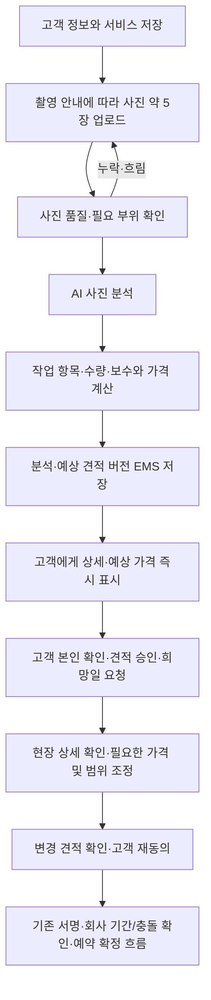

# 고객 사진 AI 예상 견적 → EMS 자동 저장 구현 계획

**후속 인수 완료(2026-10-11):** 회사 Chrome에서 실제 두 사진 업로드 → AI 분석 → 새로고침 복원 → EMS 동일 결과를 확인했다. 새 가격 SQL 적용과 익명 차단도 확인했다. 실제 사례는 사진 부족으로 `review_required`/총액 null이며, 전체 사진의 정상 숫자 총액 인수는 남는다. [검증 기록](../verification/2026-10-11-pricing-browser-qa.md).
2026-10-11 · Australia/Sydney · 상태: **RQ-04a 실제 API·저장 검증 완료 / RQ-04b 가격 v1 구현·자동 검사 완료 / 두 사진 추가 확인 경로 고객·EMS UI 인수 완료 / 정상 총액 실제 인수 대기**

[37번 전체 순서](37-live-quote-ems-booking-implementation.md) · [39번 초기 가격 규칙](39-sydney-cabinet-pricing-v1.md) · [15번 TODO](15-home-cabinet-admin-todo.md)

## 1. 최신 사용자 결정

고객이 일반 Kitchen Cabinet Painting 페이지에서 Quote를 진행하고, 전체 전면·측면·심한 손상 등 필요한 정보를 담은 사진 약 5장을 올린다. AI API가 사진을 분석해 작업 상세와 예상 가격을 고객에게 바로 보여준다. 사진·분석·견적 결과는 같은 요청으로 EMS에 자동 저장한다. 현장에서 더 자세히 확인한 뒤 필요하면 가격을 조정한다.

10월 8일의 회사 수동 금액 선확정 방식을 기본 고객 흐름에서 대체한다. EMS는 자동 결과 확인과 현장 조정·이력 관리에 사용한다. 담당자 검토는 정보 부족·분석 실패·예외 항목과 현장 조정에 남긴다. RQ-00~02 저장은 보존한다. 실제 AI 분석과 저장 일치, 동일 작업 재호출의 중복 방지를 확인했다. 사용자가 GST 별도 시작가 A$1,500을 확정했고, 승인된 초기 예상 견적 규칙 `lk-sydney-cabinet-v1-20261011`을 구현했다. 회사 Chrome에서 실제 두 손상 사진의 분석·추가 확인 안내·금액 보류·새로고침 복원·EMS 동일 결과를 확인했다. 전체 범위와 수량이 확보된 실제 사진의 정상 숫자 총액 인수 및 현장 가격 조정은 후속이다.

## 2. 고객 흐름과 완료 목표

사진 기반 금액은 예상 견적이며 현장 확인으로 달라질 수 있음을 금액 바로 옆에 표시한다. 현장 방문의 예약 시점·비용·작업 시작과의 관계는 아직 확정하지 않는다. 기존 원칙인 예약된 날짜 차단·회사 기간/충돌 확인 후 확정과 가격/범위 변경 시 고객 재동의는 유지한다. 예상 금액을 본 행위를 계약 서명·결제·예약 확정으로 취급하지 않는다.

‘바로 표시’는 고객의 현재 Quote 화면에서 회사의 수동 입력을 기다리지 않고 분석 완료 후 결과를 표시한다는 뜻이다. 분석 중·추가 사진 필요·재시도 상태를 제공하며 처리 시간을 측정하기 전 초 단위 완료 시간을 약속하지 않는다.

## 3. 사진 약 5장 촬영 안내

아래 다섯 촬영 항목은 구현 제안이다. 장수만 채워 분석을 통과시키지 않고 실제 필요한 부위가 보이는지 검사한다.

| 안내 항목 | 확인할 정보 |
| --- | --- |
| 전체 전면 | 전체 캐비넷 배치와 작업 범위 |
| 상부장 전면 | 상부 문·모서리·표면 상태; 상부장이 없으면 없음 선택 |
| 하부장·서랍 전면 | 하부 문·서랍 수와 싱크 주변 상태 |
| 측면·끝판 | 측면·노출 프레임·끝판 작업 여부 |
| 가장 심한 손상 근접 | 박리·찍힘·벌어짐 등; 손상이 없으면 없음 표시와 대표 표면 사진 |

- 같은 사진 반복으로 빈 항목을 대체하지 않는다. 한 사진이 여러 부위를 충분히 담으면 해당 근거를 함께 사용할 수 있다.
- 흐림·너무 어두움·가림·대상 외 사진·필수 범위 누락이면 구체적인 재촬영 안내를 준다. ‘약 5장’을 정확히 5장만 허용하는 제한으로 구현하지 않는다. 추가 사진은 기존 최대 8장 후보 안에서 필요 범위를 보완한다.
- 고객 입력 문/서랍 수와 AI 추정을 비교하고 불일치할 때 확인·수정하게 한다. 측정 기준 없는 사진에서 정확한 치수·면적·숨은 재질을 단정하지 않는다.
- 비공개 저장·소유권·형식/용량/픽셀 검사·메타데이터 제거를 먼저 완료한다. 공개 버킷을 만들지 않는다. Vercel 큰 사진 처리에는 37번의 직접 업로드·검사 경로를 사용한다. 함수 본문 한도는 [공식 제한](https://vercel.com/docs/functions/limitations)을 적용한다.

## 4. AI 분석과 가격 결과

AI 출력은 구조화된 데이터로 검증한다. 관찰마다 근거 사진 ID·위치, 손상 종류, 관찰 설명, 추정 수량, 필요 작업 후보와 현장 확인 항목을 기록한다. 여러 사진의 동일 부위/손상은 하나로 묶어 수량·보수비 중복을 막는다. 모델의 자기 확신 점수를 검증된 정확도 확률로 표시하지 않는다.

구현은 **AI가 작업·수량·보수 항목을 분석하고, 서버가 승인된 초기 가격 기준으로 예상 금액을 계산**하는 방식이다. 고객은 이를 하나의 자동 견적 결과로 본다. `lk-sydney-cabinet-v1-20261011`은 L&K의 초기 프로젝트 예상 견적 규칙이며 확인된 Sydney 시장 평균을 뜻하지 않는다. 최소 도장비·문/서랍 단가·보수 가산·세금·반올림·상태 및 저장 계약은 [39번 가격 문서](39-sydney-cabinet-pricing-v1.md)에 기록한다. 견적 유효기간·현장 방문 정책은 후속 결정이다.

최소 도장비 A$1,500, 문당 A$150, 서랍 앞판당 A$100은 GST 별도다. 도장비는 `max(1500, 문 수 × 150 + 서랍 수 × 100)`으로 계산하고, 중간 정도 도막 보수는 프로젝트당 A$250을 한 번 가산한다. 소계에 GST 10%를 더하며 정수 cents로 저장한다. 정상 결과는 `estimate_ready`로 단일 예상 총액과 항목·소계·GST를 표시한다. 사진 부족·수량 불일치·심한/구조적 손상·별도 범위는 `review_required`로 금액을 모두 null로 두고 보완 사유와 시작가만 표시한다. 선택하지 않은 표면의 양수 수량이나 보수만 요청한 범위도 전체 예상 총액을 계산하지 않는다. AI가 달러 금액을 생성하거나 이전 데모 AUD 1,250을 운영값으로 사용하는 경로는 허용하지 않는다. 이전 `unconfigured`/`awaiting_company_rates` 결과는 역사적 저장본으로 보존한다.

고객 결과 화면에는 다음을 보여준다.

- 사진에서 확인된 상태·손상과 근거 사진.
- 예상 작업 항목·수량·포함/제외 범위·항목별 금액과 합계.
- 사진 기준의 가정, 고객 확인이 필요한 수량/정보, 현장에서 추가 확인할 사항.
- 예상 견적 참조번호·버전·산정 시각·현장 확인 후 조정 가능 안내.

정보가 부족하면 추가 입력·재촬영을 먼저 요청한다. 계산 불가능한 항목은 제외했다고 명확히 표시하거나 현장 검토로 보내며, 부분 금액을 전체 예상 총액처럼 표시하지 않는다. 고객에게 검증되지 않은 원시 모델 응답을 바로 스트리밍하지 않는다.

## 5. EMS 저장·권한·버전

사진 manifest/hash, 입력 revision, AI 제공자/모델·프롬프트·스키마 버전, 검증된 분석, 가격 기준 버전, 계산 결과, 표시한 예상 견적 버전을 같은 요청에 연결한다. 분석/계산 결과와 고객/EMS가 읽는 저장본을 한 트랜잭션으로 확정한 뒤 성공을 표시한다. EMS 저장 실패를 성공 견적으로 표시하지 않는다.

현재 작성 세션 소유자는 그 세션의 사진 분석·예상 견적을 바로 조회한다. 최초 예상 결과 확인을 직원 승인이나 이메일 OTP 뒤로 미루지 않는다. RQ-05 본인 확인은 다른 기기 복귀·만료 후 복구·공식 승인/서명에 적용하며, 입력 이메일만으로 기존 고객 자료를 합치지 않는다.

기존 `review_requested`는 고객 편집 잠금 상태다. 단순히 버튼 이름을 바꾸지 않고 `분석 중/추가 사진 필요/예상 견적 준비/현장 확인 필요` 분석 상태를 별도로 설계한다. 추가 사진·수량 수정 후 새 분석을 요청할 수 있는 명시적 명령을 추가하고 과거 제출/서명 잠금은 유지한다. SQL 상태 제약·도메인 타입·응답 파서·고객/EMS 화면을 함께 확장하고 신규 분석 API도 `/api/quote/requests`의 작성 권한 경계를 따른다. 기존 검토 요청을 자동 분석하거나 유료 API로 일괄 전송하지 않는다.

사진·수량·서비스가 바뀌면 이전 결과를 오래된 견적으로 표시하고 새 입력 버전으로 계산한다. 늦게 도착한 분석이 최신 결과를 덮어쓰지 않게 한다. 기존 견적을 승인한 뒤 현장에서 금액·범위가 바뀌면 새 버전·수정 사유·행위자를 남기고 고객 재동의/필요 재서명을 받는다. 과거 승인·서명을 덮어쓰지 않는다.

## 6. 처리 구조와 외부 연동

기존 Next.js Route Handlers·회사 Supabase·업무 모듈을 유지한다. 사진 업로드, 분석 작업 생성, 결과 조회를 분리한다. 분석은 영속 작업 ID·고유 중복키·lease·시간 제한·재시도 횟수를 가지며 새로고침 후 같은 작업을 복원한다. 배포에서 실제 실행할 worker/작업 runner를 함께 확인하고 HTTP 응답 종료 뒤의 메모리 작업에 의존하지 않는다. 새로운 유료 queue/프로젝트 생성은 이번 문서 개정으로 승인하지 않는다.

분석 키는 요청 ID·입력 revision·사진 manifest·분석/가격 기준 버전에 묶는다. 같은 요청의 재클릭·응답 유실로 분석 작업/견적 버전을 중복 만들지 않는다. 제공자 호출 결과가 불명확한 경우의 중복 과금 가능성은 제공자 계약에 맞춰 대사·재시도한다. 시스템이 정확히 한 번 과금됨을 보장한다고 쓰지 않는다.

AI는 OpenAI `gpt-6.1-sol / medium`으로 확정했고 서버 전용 `OPEN_AI_API_KEY`를 연결했다(표준 `OPENAI_API_KEY`도 지원). 공식 Responses/구조화 출력 계약을 확인했다. `store:false`, 사진 준비 30초·AI 120초·lease 240초·최대 출력 8,000토큰과 요청당 최대 3회 명시적 시도를 적용한다. 토큰 사용량/추정 비용을 기록하며 운영 호출 예산 조정은 후속이다. 현재 회사 저장 동의만으로 외부 AI 전송까지 동의했다고 간주하지 않는다. 고객에게 선택한 제공자의 AI 분석 목적/사진 처리 내용을 안내하고 필요한 동의를 받은 사진/작업 정보만 보낸다. 연락처·전체 주소·서명은 사진 분석 요청에서 제외한다. 사진 속 텍스트는 자료로 취급하며 가격/권한/시스템 지시를 바꾸는 명령으로 실행하지 않는다. 모델에는 DB 변경·메일·Calendar 도구 권한을 주지 않는다.

## 7. 순차 구현·완료 기준

1. **RQ-03 촬영 안내·비공개 업로드:** 약 5장의 필요 부위 안내, 실제 사진 저장·복원·EMS 열람, 누락/흐림·큰 파일·실패 재시도·타인 접근 차단.
2. **RQ-04a AI 분석:** 제공자 어댑터·영속 분석 작업·구조화 결과·근거 사진·수량 확인·추가 사진 안내. 지정 손상 사진 두 장은 손상 사례로 재사용하되 전체 전면/측면이 확보된 5장 세트라고 주장하지 않는다.
3. **RQ-04b 자동 예상 견적·EMS 저장:** 승인 가격 기준 버전과 금액 계산, 현재 고객 화면 즉시 표시, EMS 동일 요청/결과/버전 확인. 가격 v1의 코드·자동 검사와 실제 두 손상 사진의 고객·EMS 추가 확인 경로 UI 인수는 완료했다. 충분한 사진과 수량으로 정상 총액을 산정하는 실제 인수는 남는다. `review_required`는 추가 사진/확인 경로로 검증하며 정상 총액 사례의 운영 인수를 대신하지 않는다.
4. **RQ-04c 현장 조정:** EMS 변경 항목·사유·새 금액/버전, 이전 결과 보존, 고객 재확인 경로. 현장 방문 정책 미정값은 임의 확정하지 않는다.
5. **통합 인수:** 사진 → 분석 → 예상 견적 → EMS 일치, 중복 손상/호출, 실패·새로고침·stale 결과·수량 변경·가격 조작·권한·모바일 검증. 전문가가 확인한 사진 사례와 계산 기대값을 대조하고 근거 없는 분석/가격 노출을 막는다. 정상/어려운 사례의 지연시간을 측정하고 분석 품질·누락·오계산 허용 기준을 운영 활성화 전에 확정한다.
6. **후속 RQ-05~09:** 고객 본인 확인·승인, 날짜·정식 약관·서명, 문서/메일, 회사 기간/충돌 확인·Google 확정, Vercel 운영 인수. EMS 집계/KPI는 이후다.

## 8. 10월 11일 구현 결과와 다음 단계

### 가격 규칙 적용 전 실제 분석 기록

사진 업로드·메타데이터 제거·AI 구조화 분석·영속 작업/재시도·고객/EMS 동일 저장본 화면을 구현하고 회사 Supabase에 신규 SQL을 적용했다. 지정 손상 사진 두 장의 실제 업로드·조회, 익명 접근 차단, 기존 자료 보존을 확인했다. 최초 API 시도는 `2026-10-11` 검증 당시 HTTP 429 `credit_balance_exhausted` / `insufficient_quota`로 실패했으며, 이는 이후 재시도로 해결된 역사적 결과다. 후속 실제 `gpt-6.1-sol / medium` 분석은 31.012초에 성공해 `additional_photos_required`를 반환했다(관찰 손상 4건, 작업 제안 3건). 사용량은 입력 1,782·출력 1,960(추론 215 포함)·총 3,742 토큰, 비용 추정 USD 0.023164다. 가격은 `awaiting_company_rates`, 금액 null이다. 동일 작업을 명시적으로 다시 호출해도 분석을 중복 수행하지 않았고 고객/EMS readback의 분석·가격 원본이 일치했다. 당시 브라우저 화면 인수는 별도 미완료였다.

위 결과는 가격 규칙 적용 전 기록이므로 `awaiting_company_rates`와 금액 null을 그대로 보존한다. 당시 RQ-04a의 실제 API·저장 검증은 완료됐고, 회사 창 선택 입력이 개인 창으로 전달되어 조작을 중단한 브라우저 화면 인수는 미완료였다. 상세 과거 검사·실연결·미검증 구분은 [당일 검증](../verification/2026-10-11-ai-photo-analysis.md)을 따른다.

### 가격 v1 후속 구현 및 현재 검증

RQ-04b 가격 계산·엄격한 저장 금액 검증·고객/EMS 공유 화면·추가 검토 시 총액 비공개를 구현했다. 전체 자동 테스트 **488/488**과 `npm run check`(lint·타입·production build)가 통과했다. 자동 검사는 실제 새 사진의 분석 정확도나 운영 화면 인수를 대신하지 않는다. 회사 Chrome에서 실제 두 손상 사진 업로드 → `additional_photos_required` 분석/`review_required` 가격 → 새로고침 복원 → EMS 동일 결과 확인을 완료했다. 키보드 Tab/Return 분석 시작과 320px 메뉴 열기/닫기·결과/가격 안내 가독성도 확인했으며 콘솔 오류는 0건이었다. 입력 name 보완 뒤 최신 `npm run check`도 다시 통과했다. 전체 범위 사진과 확정 수량의 실제 정상 숫자 총액 인수는 남는다. 실제 결과와 검사 범위는 [가격 브라우저 검증](../verification/2026-10-11-pricing-browser-qa.md)을 따른다. RQ-04c 현장 가격 조정·이전/새 견적 버전 보존·고객 재동의는 미구현이다. 가격 v1의 산식·예외·검사 범위는 [39번 문서](39-sydney-cabinet-pricing-v1.md)를 따른다.

로컬 worker의 단발/반복 실행을 확인했다. 반복 worker는 15초 간격으로 실행 중이며 실패 작업의 자동 유료 재시도는 하지 않는다. 이는 Vercel 상시 worker 배포·운영 인수를 대신하지 않는다.
