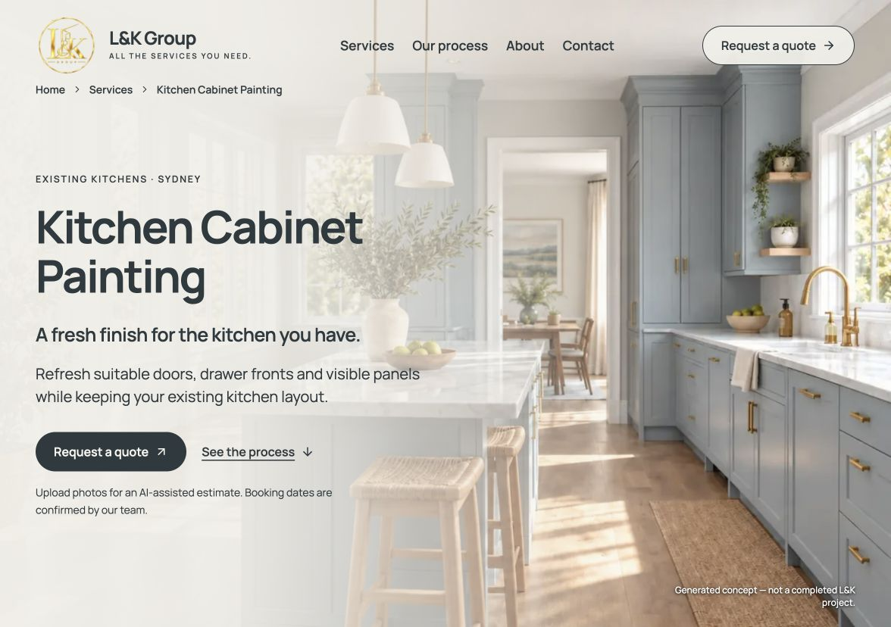
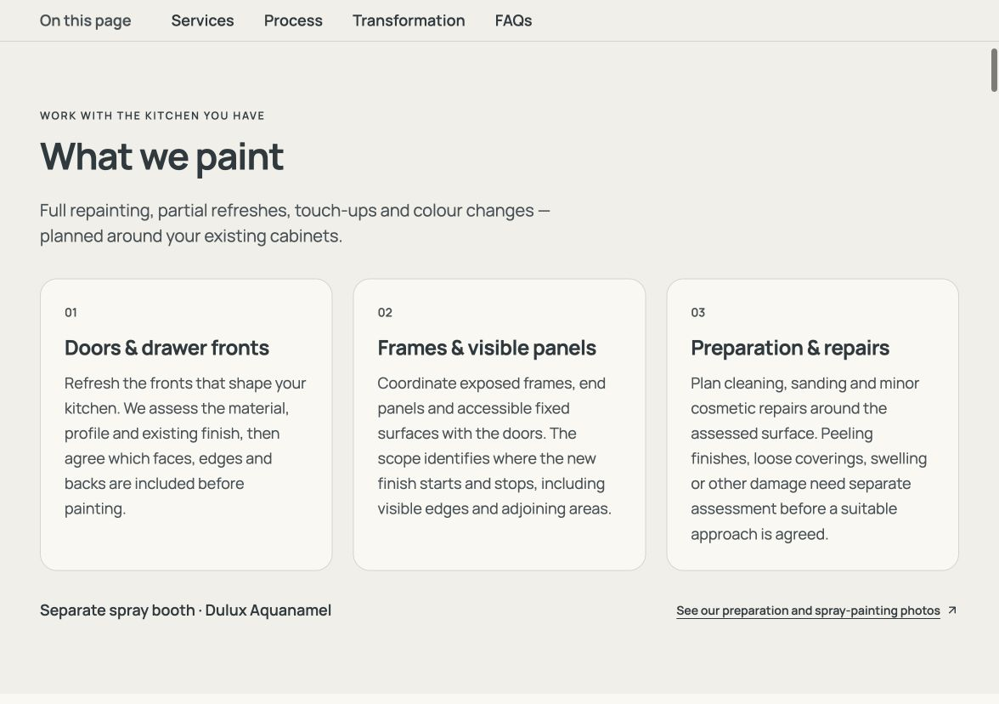
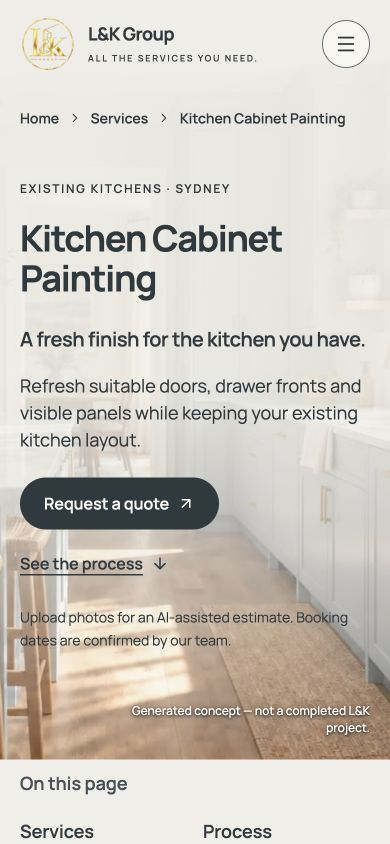

# KCP 브라우저 주석 6개 — 디자인 보정

2026-10-13 · [47번 랜딩 계획](../plans/47-kcp-landing-ui-ux-content-plan.md)의 후속 수정. 사용자 주석의 Hero 문단/버튼, 목차, 이미지 고지, 카드 모서리, 제품명, 공정 링크를 반영한다.

## 디자인 분석과 적용

| Before | After | Why |
| --- | --- | --- |
| Hero 제목·설명 사이 12~16px, 버튼과 안내의 실제 간격 0px | kicker→제목 20px, 제목→tagline 28px, tagline→본문 20px, 본문→CTA 32px(모바일24px), CTA→안내16px | 제목·설명·행동·보조 안내의 구분을 명확하게 함 |
| 버튼 크기·굵기와 표시 규격이 개별 규칙으로 계산됨 | 주요 CTA 높이52px·Manrope16px/600·행간1.25·아이콘18px·간격8px | Hero·하단 견적·KCP 헤더에 일관된 행동 규격 제공 |
| Explore 라벨12px/400·대문자, 링크 약20px/600 | On this page 라벨과4링크 모두 Manrope18px/600·행간1.35·일반 자간 | 같은 내비게이션 안의 서체/크기 불일치 제거 |
| 14px 어두운 고지와 큰 밝은 배경 박스 | 12px/500 흰색 고지·배경/패딩 제거·우측 하단·작은 shadow | 생성 이미지 안내를 보존하면서 사진 흐름을 덜 가림 |
| 각진 서비스 카드 | 20px 모서리·안쪽28px(모바일24px)·카드 간격24px(모바일20px) | 카드 형태와 여백을 정돈함 |
| Dulux Aqua Enamel | Dulux Aquanamel | 사용자 제품명 정정 반영 |
| bare text와 문자↘ 각각에 밑줄이 생기는 flex 링크 | 텍스트 span에만 밑줄·Lucide SVG16px·6px 간격·축소 방지 | 문구와 화살표가 떨어져 보이는 현상을 해결 |

Hero 안내가 CTA에 붙던 원인은 `.kcp-page p { margin-top:0 }`가 낮은 우선순위의 `.kcp-hero-status` 여백을 덮는 CSS 선택자 충돌이었다. Hero를 flex column으로 정리하고 직접 자식의 명시적 여백으로 실제 간격을 보장했다. Hero 타이포의 기존 `!important` 의존을 제거했다.

KCP 안에서만 control/spacing/radius 토큰을 재사용하고 공용 Manrope·색상 토큰은 유지했다. 모바일 Hero의 CTA는 왼쪽으로 세로 배치하고 목차는2열을 유지한다. 다른 route의 헤더를 바꾸지 않도록 헤더 스타일을 `body:has(.kcp-page)`에 한정했다. 본문·지역·견적 조건·SEO·3D 공정 진행/엔진을 변경하지 않았다.

## 검증

- 구현 담당자가 대상 TSX/content lint, `tsc --noEmit`, 대상 diff 검사를 실행해 통과했다.
- Root Codex 브라우저1176×828에서 실제 Hero 간격20/28/20/32/16px, CTA52px/16px/600, 목차18px/600, 카드 radius20px, 흰 고지12px/투명 배경을 확인했다.
- Root390×844에서 Hero 문단·CTA·우측 하단 고지와 줄바꿈을 확인했다. 공정 링크의 텍스트만 밑줄과SVG6px 간격을 확인했다.
- 최신 전체 `npm run lint`, `npm run typecheck`, `npm run build`가 모두 exit0으로 완료됐다. 초기 lint에서 동시에 구현 중인 메인의 새 public entry import 제한 오류가 발생했으며, 해당 작업 담당자가 공개 진입점을 수정한 뒤 재검사했다. KCP 작업에서 메인 코드를 되돌리거나 검사를 제외하지 않았다.
- 최신 production3019의 브라우저 **16개 시나리오 통과**. [최종 결과](2026-10-13-kcp-design-polish/results.json)는 viewport9개, 목차·FAQ·모바일 메뉴·키보드/터치 전후 비교·견적 시작, 9단계/hash/역스크롤/빠른 왕복, 실제 crossfade, 정적 보기 반복, reduced-motion, JS 비활성, WebGL 초기/소개/컨텍스트 상실을 포함한다. 외부 요청과 API는 fixture로 응답했고 회사 자료를 생성/변경하지 않았다.
- 동시에 개편된 홈의 지역 제목이 H3그룹3개에서 H3아래 H4그룹3개로, 구분자가 쉼표에서 `·`로 바뀌어 초기 SSR 검사가 실패했다. 검증 코드를 의미 기준으로 갱신해 **3개 목록·중앙21지역의 정확한 순서·반경 밖 안내·About 중복 없음·지도·metadata·KCP 요약1회·JS 비활성 FAQ**의 조건을 유지했다. 앱 조건을 약화시키거나 검사를 삭제하지 않았다.
- SSR 재실행에서 다른 빌드가 `.next`를 갱신해 이전 서버의 manifest가 사라진 CSS 파일을 가리키는500오류를 발견했다. Root 소유의 미리보기 서버를 최신 빌드로 재시작하고 같은 SSR 시나리오를 다시 실행해 CSS/이미지 로드 및 pageErrors0을 확인했다. [초기 결과](2026-10-13-kcp-design-polish/initial-results.json), [CSS 실패](2026-10-13-kcp-design-polish/rerun-ssr/results.json), [성공 재실행](2026-10-13-kcp-design-polish/rerun-ssr-2/results.json)을 보존했다.
- 최종390px 화면에서 CTA52px, 안내 간격16px, 고지12px/white, 문서 폭390px을 실제 확인했다. 320px에서도 문서 폭320px과 고지/버튼의 화면 내 배치를 확인했다. 콘텐츠가 긴 작은 화면은 자연스럽게 스크롤하며 본문을 잘라 고정하지 않는다.
- QA analyst가 최종 데스크톱/모바일 화면과 결과를 읽기 전용으로 검토했으며 이번6개 주석 범위에서 추가 확정 결함은 없었다. React Best Practices 검토에서 서버 콘텐츠/장식 아이콘의 aria-hidden/기존 dynamic 3D 분리·동작을 보존했으며 신규 상태·네트워크 의존성을 추가하지 않았다.

## 최종 화면

## 범위와 제한

커밋·푸시·병합·운영 배포는 요청 범위에 포함하지 않는다. 실제 휴대폰/Safari, 실제 브라우저200% 확대, 정량 GPU/프레임 성능은 이번 보정에서 실행했다고 표시하지 않는다. 생성 이미지를 실제 시공 사례로 표현하지 않는다.
