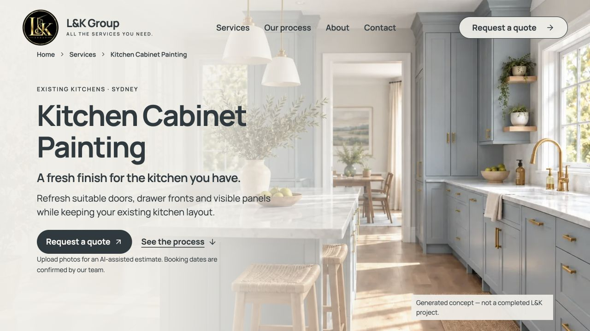
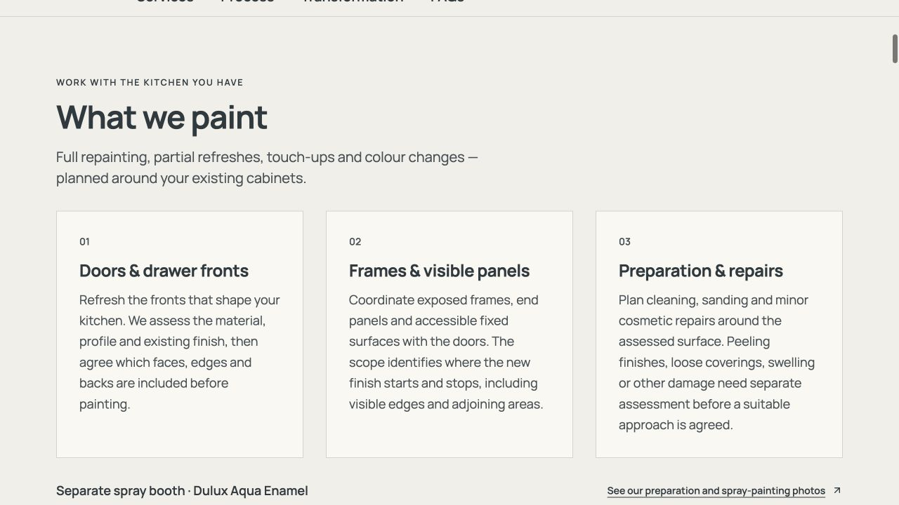
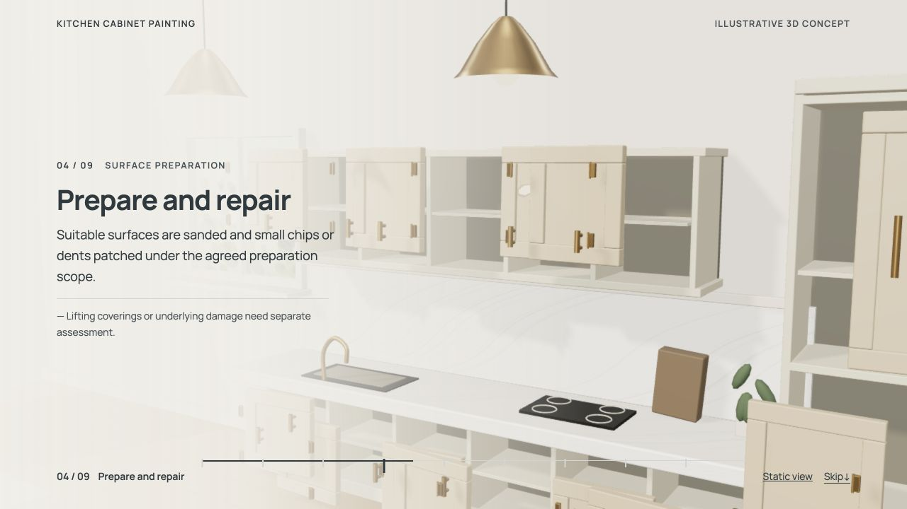
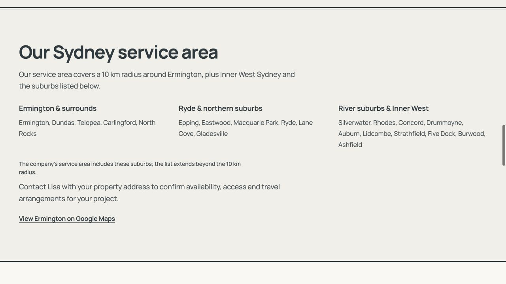

# KCP 랜딩페이지 UI·UX 구현 및 검증

기준: [47번 계획](../plans/47-kcp-landing-ui-ux-content-plan.md) · 2026-10-13 로컬 검증. 운영 사이트 배포와 구분한다.

## 구현 결과

- 사진 Hero → 서비스 3영역 → 9공정+완성 장면 → 전후 비교 → 작업 범위 → FAQ 5개 → 견적·지역 요약으로 재구성했다.
- 반복 소개, 별도 품질/교체 비교/예시 섹션을 서비스·범위·FAQ에 통합했다. 신규 캐비넷 제작/설치 제외, 손상 별도 평가, 포함 면/철물 확인, 추가 비용과 회사 일정 확인 조건은 유지했다.
- 별도 색상·광택 쇼룸의 UI, 상태, dynamic import와 CSS를 삭제했다. **공정 3D 모델·스크롤·패치·두 마감 코트·재조립·전후 비교는 유지**했다.
- 홈 About 안의 지역 목록을 독립 `#service-area` 섹션으로 옮겼다. 중앙 데이터의 세 그룹·21개 지역, Ermington 10km와 Inner West/반경 밖 명시 지역 조건, 주소 확인과 지도 링크를 재사용했다. KCP에는 지역 한 문장과 `/#service-area` 링크만 남겼다.
- Manrope와 기존 색상·글자·굵기·컨테이너·모션 토큰을 사용했다. 서비스 카드는 3/2/1열이며, 본문 폭·행간·제목 크기·섹션 간격을 정리했다. 모바일 Hero의 사진 초점을 우측 캐비넷으로 조정하고 사진 위 헤더 버튼에 밝은 배경을 넣었다.
- `/services/cabinet-painting` URL, 서버 H1/본문/FAQ, 고유 metadata, 기존 사진 기반 견적 시작 경로를 유지했다. 생성 이미지 고지를 보존했고 `noindex`를 변경하지 않았다.

## 모션 및 수정한 오류

네이티브 스크롤과 기존 KitchenScene 렌더러를 유지했다. 읽는 중심과 클릭/hash/복원 progress 계산을 통일했고, chapter는 82svh를 기준으로 내용이 길면 확장된다. 첫 3D 프레임이 준비된 뒤 poster와 canvas가 함께 420ms 교차 전환한다. 근접 카메라 이동량을 낮추고 진입/복귀 구간을 넓혔다.

1. 첫 chapter를 화면 중앙에 정렬하면 전체 높이의 stage 하단 버튼이 잘렸다. 향상 모드의 chapter 앞에 9svh 여백을 두어 첫 단계부터 stage가 화면 상단에 고정되게 수정했다. 첫 단계/완성 장면과 지원 경계의 버튼 좌표를 재검증했다.
2. 정적 보기의 Return 버튼이 사라질 때 blur가 발생하지 않으면 읽는 단계 추적이 잠길 수 있었다. 전환/복원 시 잠금을 명시적으로 해제했다. 다른 공정으로 이동하며 정적↔3D를 두 번 왕복해 확인했다.
3. 3D 사전 로딩 중 WebGL이 실패하면 아직 공정 소개를 읽는 사용자가 첫 chapter로 이동할 수 있었다. 현재 chapter가 화면 중앙의 읽는 지점을 포함할 때만 그 chapter를 복원하게 변경했다. 소개를 읽는 중 실패에서는 현재 스크롤과 외부 포커스를 보존했다.
4. 짙은 캐비넷 사진 위의 헤더 견적 버튼 대비가 낮았다. KCP에만 밝은 veil 배경과 foreground 글자/테두리를 적용했다.

3D 표시 조건은 기존의 **폭 1024px 이상·높이 700px 이상·모션 감소 설정 없음**이다. 좁은 화면·모션 감소·WebGL 실패는 같은 공정 사진과 서버 본문을 제공한다. 현재 Codex 패널 폭이 753px이면 정적 화면이 정상적으로 표시된다. 모델 삭제와 구분한다.

## 실행 증거

검증 스크립트: [verify-kcp-landing-ui.mjs](../../scripts/verify-kcp-landing-ui.mjs). 격리된 Chrome context를 사용하고 외부 요청을 차단하며 모든 `/api` 요청을 브라우저 fixture로 응답했다. 실제 고객 정보·사진·견적·예약·메일·Google 자료를 생성하거나 변경하지 않았다.

- 관련 타임라인 단위 검사 **8/8 통과**: 경계 연속성, 유한/범위 값, 순·역방향 및 빠른 점프의 동일 상태, 패치→프라이머→두 코트 순서, 재조립 완료, 카메라 변화량을 검사했다.
- 로컬 production 빌드 `127.0.0.1:3019`의 브라우저 **16개 시나리오 통과**. [통합 결과](2026-10-13-kcp-landing/results.json)에 초기 실패와 성공 재실행의 출처를 기록했다.
- 320×568, 390×844, 768×1024, 1280×720, 1440×900과 1023/1024px·699/700px 경계에서 가로 넘침, 중복 ID, H1 1개, 목차 앵커, FAQ Enter, 모바일 메뉴 Escape/포커스 복귀를 확인했다.
- 초기 서버 HTML/JS 비활성 모드에서 홈의 21개 지역·경계 조건, KCP 짧은 지역 요약·FAQ·공정 본문과 고유 metadata를 확인했다.
- 전후 비교 pointer 드래그와 range Home/End, 견적 CTA 경로·시작 화면, 실제 연락 링크를 확인했다. 견적 입력/저장/제출은 수행하지 않았다.
- 9개 공정 링크, 중간 hash 직접 진입·새로고침, 시작→완성→역방향/빠른 왕복, 현재 단계와 progress 일치, 정적 전환 2회, 런타임 reduced-motion과 크기 경계 복원을 확인했다.
- 실제 poster/canvas opacity 중간 프레임을 기록해 교차 전환을 확인했다. WebGL 초기 실패·소개 사전 로딩 실패와 `WEBGL_lose_context` 확장을 통한 컨텍스트 상실에서 본문·현재 단계·위치 보존을 확인했다.
- 200% 글자 확대 시뮬레이션과 모션 감소 시작 화면에서 본문/FAQ/사진 읽기를 확인했다. 실제 브라우저 확대와 구분한다.
- 최종 모바일 사진 초점/헤더 대비 보정 빌드에서 390px와 200% 글자 확대를 재실행해 통과했다. lazy 이미지의 완료/디코딩을 기다린 뒤 캡처했고 준비 사진이 정상 표시됐다. [최종 모바일](2026-10-13-kcp-landing/final-mobile/viewport-390x844.png) · [글자 확대](2026-10-13-kcp-landing/final-enlargement/reduced-motion-startup-and-text-200-percent-simulation.png).
- Codex 브라우저에서 최종 Hero/3D Prepare/모바일 화면, KCP→홈 서비스 지역 링크 실제 이동을 확인했다. 최종 3D 화면의 현재 단계는 `04 / 09`, canvas는 ready이며 확인 구간의 console error/warn은 0개다. QA analyst가 최종 화면과 인수 결과를 읽기 전용으로 검토했으며 추가 확정 결함은 없었다.

초기 브라우저 실행의 두 실패는 same-document hash 이동의 HTTP 응답 `null` 처리와 복원 RAF 전 포커스 확인이라는 검증 코드 오류였다. 재실행 중 `requireFocus` scope 오류도 수정했다. 앱 조건을 낮추거나 검사를 삭제하지 않았으며 [초기 결과](2026-10-13-kcp-landing/initial-results.json)와 실패 캡처, 성공 재실행을 보존했다.

### 같은 화면 크기의 비교

| 대상 | 변경 전 운영 화면 | 변경 후 로컬 화면 |
| --- | ---: | ---: |
| 1280×720 전체 문서 높이 | 23,048px | 약 11,516px |
| 1280×720 서비스 영역 | 2,292px | 약 780px |
| 390×844 전체 문서 높이 | 25,880px | 약 12,349px |
| 390×844 서비스 영역 | 3,032px | 약 1,210px |

현재 DOM/화면 측정이며 프레임 성능 수치가 아니다. 데스크톱 서비스 H2는 45.6px, 카드 H3는 24px, 본문은 18px/29.7px 행간이다. 생성 이미지와 실제 회사 작업 사진을 혼동하지 않게 각각의 고지를 유지했다.

### 최신 작업트리 검사 상태

- KCP 구현 및 공정 복원 수정 후 `npm run check`의 lint·타입·production build는 통과했다.
- 최종 모바일 사진 초점/헤더 대비 보정 뒤 재검사에서 별도 활성 `Quote ui/ux` 작업의 `booking-flow-panel.tsx` 중복 prop 및 새 `validated-input.tsx` ref 처리 lint 오류가 발생했다. 해당 동시 작업 담당자가 수정한 뒤 **최신 작업트리의 `npm run check`가 exit 0으로 완료됐다**. 이 작업에서 해당 입력 코드를 되돌리거나 검사에서 제외하지 않았다. 최종 production 서버를 재시작하고 모바일/글자 확대 화면을 재검증했다.
- 이번 작업은 기존 미커밋 견적 변경이 있는 `codex/quote-one-page-ux-20261013`에서 시작했다. 별도 `Main page UI·UX` 작업이 현재 체크아웃을 `codex/lk-group-home-ui-ux-20261013`로 전환했다. 이 작업에서 브랜치를 전환하거나 커밋/푸시/병합하지 않았다.

## 남은 검증 범위

- 실제 휴대폰/Safari·다른 물리 기기, 실제 브라우저 200% 확대, 프레임률/GPU·Core Web Vitals 측정은 미실행이다.
- 운영 배포, 회사 서비스/프로젝트 조건 재확인, 색인 공개·canonical·sitemap·Search Console 인수는 별도 단계다. UI 변경으로 순위나 SEO 성과를 보장하지 않는다.

## 화면

